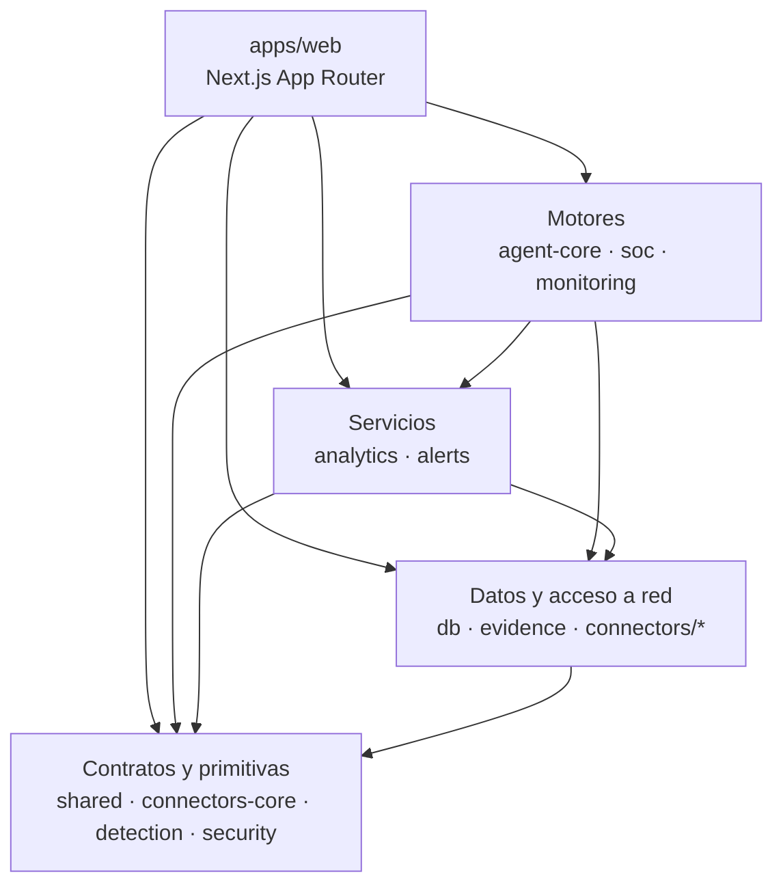

<!-- BEGIN:turborepo-agent-rules -->

# This is NOT the Turborepo you know

Turborepo configuration, task behavior, and CLI commands can vary between installed versions and may differ from your training data. Resolve the `turbo` package from this file's directory or relevant workspace; in monorepos, it may not be visible from the repository root. For example, run `node -p "require.resolve('turbo/package.json')"` from a workspace that depends on `turbo`.

Read `docs/README.md` inside that installed package first, then read the relevant pages from its `docs/` directory before changing Turborepo configuration or commands. Heed deprecation notices. These bundled docs match the installed package version and are available without network access.

This block is written and re-added by `turbo` before repository-scoped commands when an AI agent is detected. In the Turborepo source repository, its template is defined in `crates/turborepo-cli/src/cli/agent_guidance.rs`. Removing the managed block while updates are enabled means a later qualifying invocation will add it again. Set `"agentGuidance": false` in the root `turbo.json` or `turbo.jsonc` to opt out; this does not remove an existing block. Keep the block committed with your work to avoid an uncommitted change on the next agent invocation.
<!-- END:turborepo-agent-rules -->

# AGENTS.md — FTTH-Copilot

> Guía operativa para agentes y personas que trabajan en este repositorio. Los comandos, las convenciones y el checklist de entrega están acá; el mapa de módulos y los límites entre paquetes están en [`ARCHITECTURE.md`](ARCHITECTURE.md).

---

## 1. Qué es este repositorio

Monorepo pnpm + Turborepo de una plataforma NOC/SOC para ISPs FTTH: ingestión de telemetría (SmartOLT, Mikrowisp, MikroTik, SNMP, syslog), detección, correlación de incidentes y un copiloto que responde en lenguaje natural **verificando cada afirmación contra la evidencia**.

- **Stack:** Node.js 22+, pnpm 11+, TypeScript 5.7 estricto, Next.js 16 (App Router), Prisma + PostgreSQL 16, Zod, Tailwind, Vitest, Playwright.
- **Workspaces:** 16 (`apps/web`, 15 paquetes bajo `packages/`).
- **Licencia:** propietaria. Leer [`LICENSE`](LICENSE) antes de proponer cambios.

---

## 2. Preparar el entorno

```bash
pnpm install        # dependencias del monorepo
pnpm run setup      # asistente interactivo: .env, claves KMS/JWT, migraciones y seed
pnpm dev            # turbo run dev → Next.js en http://localhost:3001
```

`pnpm run setup` imprime la contraseña de administrador. Para CI o aprovisionamiento sin terminal: `pnpm run setup -- --non-interactive`.

**Requisitos:** Node.js 22+, pnpm 11+, PostgreSQL 16+ (o Docker).

---

## 3. Comandos

Todos los comandos de la raíz son tareas de Turborepo. Para trabajar sobre un solo paquete, acotá con `--filter`.

### Build, test y lint

| Comando | Qué hace |
|---|---|
| `pnpm build` | Compila los paquetes y el bundle standalone de Next.js. |
| `pnpm lint` | ESLint sobre los 16 workspaces. |
| `pnpm typecheck` | `tsc --noEmit` estricto por workspace. |
| `pnpm test` | Suite unitaria completa (Vitest). |
| `pnpm test:unit` | Solo unitarias, sin umbral de cobertura. |
| `pnpm test:coverage-check` | Verifica los umbrales mínimos de cobertura. |
| `pnpm test:e2e` | Playwright end-to-end contra la app. |
| `pnpm turbo run lint typecheck test --filter @ftth-copilot/agent-core` | Ejecuta varias tareas acotadas a un paquete. |
| `pnpm --filter @ftth-copilot/web exec playwright test` | E2E acotado a la app web. |

### Base de datos

| Comando | Qué hace |
|---|---|
| `pnpm db:generate` | Genera el cliente Prisma. |
| `pnpm db:migrate` | Crea y aplica una migración en desarrollo. |
| `pnpm db:deploy` | Aplica migraciones existentes (lo que corre producción y CI). |
| `pnpm db:seed` | Siembra el tenant de demo. |

> En producción y en CI se usa `db:deploy`, **no** `db push`. `db push` nunca ejecuta el SQL de `prisma/migrations`, así que una migración rota pasaría en verde.

### SNMP, OLT y conformance

| Comando | Qué hace |
|---|---|
| `pnpm check:sources` | Valida el registro de fuentes OLT y la deriva contra la matriz. |
| `pnpm check:conflicts` | Detecta colisiones semánticas y solapamientos de OIDs. |
| `pnpm check:contribution` | Valida la admisión de paquetes y MIBs de nuevos fabricantes. |
| `pnpm test:conformance` | Laboratorio de conformidad y golden snapshots. |
| `pnpm generate:matrix:write` | Regenera `docs/compatibility-matrix.md` desde las fuentes MIB. |
| `pnpm benchmark:snmp` | Throughput sintético del receptor SNMP. |
| `pnpm sanitize:snmp -- <in> <out>` | Sanitiza una captura antes de publicarla. |

### Cuando el proyecto ya está instalado

`pnpm install` dispara `postinstall` → `pnpm --filter @ftth-copilot/db db:generate`. Si el cliente Prisma falla por una migración nueva, `pnpm db:generate` lo arregla.

---

## 4. Convenciones

### Código

- **TypeScript estricto.** Sin `any` implícito; los tipos se validan con Zod en el borde, no con casts.
- **ESM y `"type": "module"`.** Imports relativos sin extensión `.js` en `packages/shared`.
- **Los contratos canónicos viven en `@ftth-copilot/shared`.** Un tipo duplicado en dos paquetes es un bug.
- **Los detectores son funciones puras.** Sin I/O, sin base de datos, sin `Date.now()` implícito: reciben el tiempo como parámetro. Eso es lo que los hace testeables y auditables.
- **Todo es tenant-aware.** Toda consulta, evento, clave de caché y referencia persistida lleva `tenantId`.
- **Cálculos deterministas para hechos; el LLM solo para interpretación acotada.** Un hecho medido no se le pregunta al modelo.
- **La evidencia conserva su procedencia.** Fuente, marca de tiempo y calidad viajan con la señal.
- **No se introducen escrituras activas sobre la red** (remediación SNMP, comandos a OLT) sin aprobación de diseño explícita.
- **Nada de datos reales.** Solo fixtures sintéticos o completamente sanitizados; IPs de rangos de documentación, tenants inventados, credenciales no productivas.

### Cambios

- **Una unidad de comportamiento por commit.** Tests, documentación y código de la misma regla viajan juntos.
- **Sin refactors no solicitados.** Evitar churn de formato, dependencias o archivos generados.
- **La documentación se actualiza en el mismo cambio** que el comportamiento que describe.
- **Sin `Co-Authored-By` ni atribución de IA** en los mensajes de commit.
- **Commits y PRs** según [`CONTRIBUTING.md`](CONTRIBUTING.md): Conventional Commits 1.0.0, commits atómicos, PRs chicas.

### Documentación

- **Los diagramas son código Mermaid dentro del Markdown**, nunca imágenes ni capturas. Un diagrama que no se puede revisar en un diff no es un diagrama.
- **Documentación en el idioma del documento que se extiende:** el README y `docs/architecture.md` están en español; `CONTRIBUTING.md`, `SECURITY.md` y `CHANGELOG.md` en inglés.
- **La documentación arranca por el resultado del lector**, distingue el comportamiento actual del trabajo planeado y enlaza cada afirmación con su evidencia.
- **La verdad de una afirmación vive junto al código.** Si el código cambia, la afirmación cambia en el mismo commit.

---

## 5. Arquitectura resumida



- **Las dependencias van hacia abajo.** Un paquete importa de su capa o de una inferior; nunca en círculo.
- **`db` es el único que conoce Prisma y el KMS.** `connectors-core` es el único que aplica la política SSRF. `agent-core` es el único que llama al LLM.
- **`agent-core` decide cuánto razona.** El Organic Diagnostic Router clasifica la consulta en `direct` (0 llamadas LLM), `assisted` (1) o `investigation` (hasta 6). Laya Decision Layer clasifica el evento FTTH antes, en menos de 5 ms y en shadow mode.
- **TruthGate es el último filtro.** Abstenerse sin evidencia es un resultado correcto.

Detalle completo: [`ARCHITECTURE.md`](ARCHITECTURE.md) · Modelo mental y modelo de datos: [`docs/architecture.md`](docs/architecture.md).

---

## 6. Superficies protegidas

No edites esto sin una decisión explícita y sin su verificación:

- `packages/db/prisma/migrations/` — se aplican con `db:deploy` en producción y CI.
- `packages/db/src/generated/` — cliente Prisma generado.
- `research/olt/` y `docs/compatibility-matrix.md` — fuentes MIB auditadas; CI falla si la matriz deriva.
- `packages/eval/` — gate adversarial con attack-pass-rate 100%.
- `packages/monitoring/tests/conformance/golden/` — golden snapshots del laboratorio de conformidad.
- `openspec/changes/archive/` — historial congelado.
- `LICENSE` — términos propietarios.
- `.env` y `.env.prod` — nunca se commitean.
- El bloque gestionado de Turborepo de este archivo — lo reescribe `turbo`.

---

## 7. Checklist de entrega

Antes de dar por terminado un cambio:

- [ ] El comportamiento nuevo tiene un test que lo cubre y falla sin el cambio.
- [ ] `pnpm lint`, `pnpm typecheck` y `pnpm test` pasan (o el fallo está reportado con su causa exacta).
- [ ] `pnpm test:e2e` corrió si el cambio toca journeys de usuario, API, autenticación o persistencia.
- [ ] La documentación afectada se actualizó en el mismo commit.
- [ ] No hay secretos, datos reales ni capturas sin sanitizar en el diff.
- [ ] El aislamiento por tenant y la autorización se tuvieron en cuenta.
- [ ] Los checks omitidos o fallidos están escritos en la descripción del PR. Un check que no corrió no se reporta como verde.
- [ ] El mensaje de commit sigue Conventional Commits 1.0.0.

---

## 8. Referencias

| Documento | Para qué |
|---|---|
| [`ARCHITECTURE.md`](ARCHITECTURE.md) | Mapa de módulos, límites, flujo de datos y superficies protegidas. |
| [`CONTRIBUTING.md`](CONTRIBUTING.md) | Proceso de contribución, commits y revisiones. |
| [`SECURITY.md`](SECURITY.md) | Reporte de vulnerabilidades y límites de investigación. |
| [`docs/architecture.md`](docs/architecture.md) | Modelo mental, pipelines y modelo de datos. |
| [`docs/quickstart.md`](docs/quickstart.md) | Los tres entornos de ejecución. |
| [`docs/testing-without-hardware.md`](docs/testing-without-hardware.md) | Simular incidentes sin OLT físico. |
| [`docs/contributing-snmp.md`](docs/contributing-snmp.md) | Aportar fuentes, capturas y adaptadores SNMP. |
