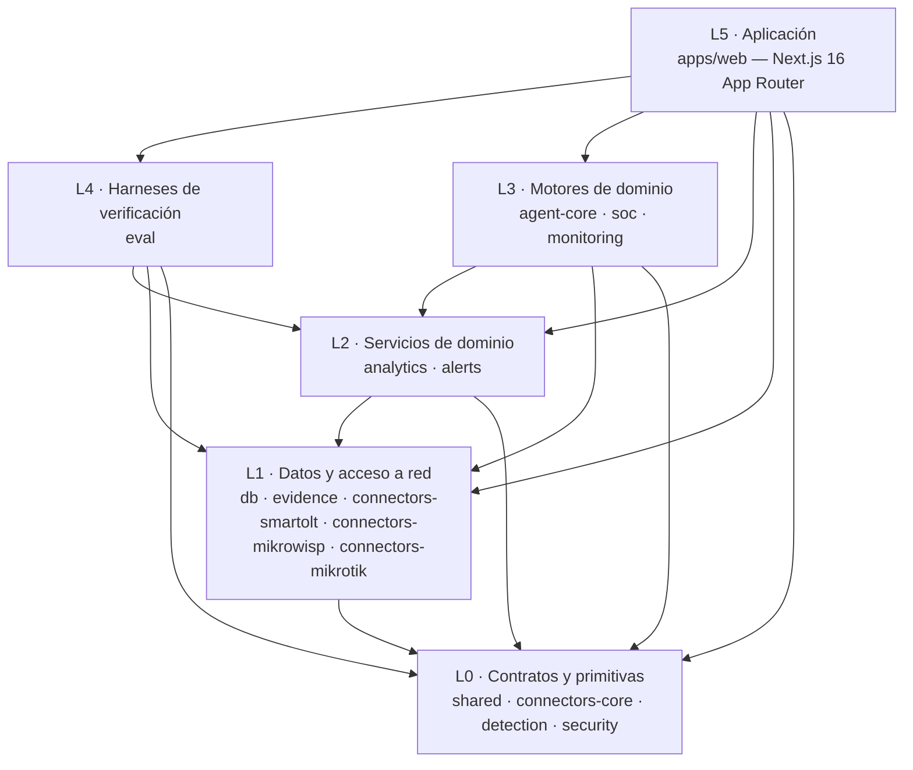
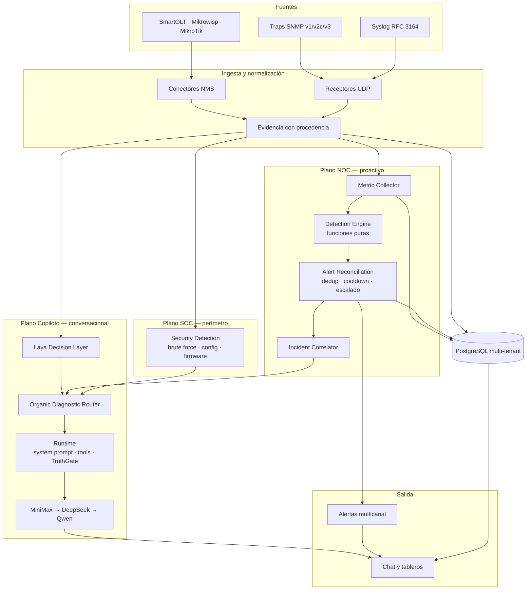
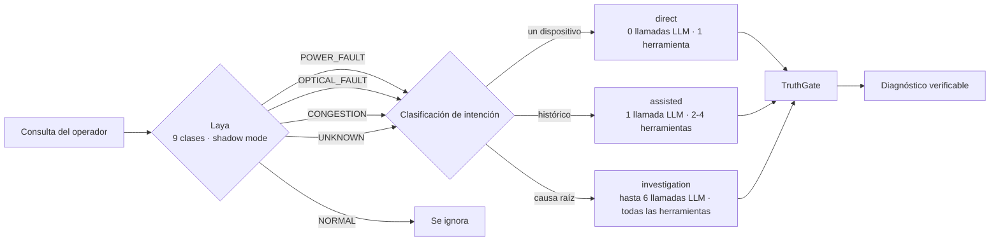

# Arquitectura — FTTH-Copilot

> **Qué es este documento:** el mapa del repositorio. Dice **qué módulos existen**, **qué puede depender de qué**, **cómo circula el dato** y **qué superficies no se tocan sin una decisión explícita**.
>
> **Para quién:** quien va a modificar código en este monorepo. Si lo que necesitás es el modelo mental del sistema (pipelines, entidades, ciclo de vida de una alerta), ese documento más profundo es [`docs/architecture.md`](docs/architecture.md). Si lo que necesitás es correr comandos, es [`AGENTS.md`](AGENTS.md).

---

## 1. Principios de diseño

Cuatro invariantes atraviesan todo el sistema. Un cambio que las rompa no es un cambio de estilo: es un defecto.

| Invariante | Qué significa en código |
|---|---|
| **Tenant-aware** | Toda consulta, evento, clave de caché y referencia persistida lleva `tenantId`. No hay datos compartidos entre ISPs. |
| **Evidencia first** | TruthGate rechaza afirmaciones que la evidencia no sostiene; abstener es un resultado válido, no un fallo. |
| **Fail-open** | Si Laya no responde, el pipeline continúa. Si el LLM falla, hay fallback. La degradación se registra, no se esconde. |
| **Shadow mode first** | Laya decide pero solo registra hasta que la accuracy medida justifique que influya en el routing. |

---

## 2. Mapa de módulos

El monorepo es un pnpm workspace con Turborepo: `apps/*`, `packages/*` y `packages/connectors/*` (**16 workspaces**). Los paquetes se organizan en capas y solo se importan **hacia abajo**.

### 2.1 Responsabilidad por workspace

| Workspace | Capa | Responsabilidad | Depende de |
|---|---|---|---|
| [`apps/web`](apps/web) | L5 | Next.js App Router: chat con IA, tableros NOC/SOC, endpoints REST, middleware de sesión, E2E Playwright. | todos salvo `alerts` y `detection`, que llegan por `monitoring` y `soc` |
| [`packages/eval`](packages/eval) | L4 | Arnés de evaluación estricto (attack-pass-rate 100%) y corpus adversarial con tenants piloto. | `agent-core`, `db`, `evidence`, `shared` |
| [`packages/agent-core`](packages/agent-core) | L2 | Motor cognitivo: Organic Diagnostic Router, motor de investigación, registro de herramientas (10 tools NMS), prompts, cliente LLM con cadena de fallback, trazas OTLP. | `connectors-core`, `connectors-smartolt`, `db`, `evidence`, `shared` |
| [`packages/soc`](packages/soc) | L3 | Orquestación perimetral, correlación de accesos anómimos, auditoría de firmware con trazabilidad por tenant. | `alerts`, `connectors-core`, `db`, `security` |
| [`packages/monitoring`](packages/monitoring) | L3 | Receptor binario SNMP, adaptadores OLT multi-fabricante, decodificación multi-vendor, catálogo OID, laboratorio de conformidad. | `alerts`, `analytics`, `connectors-core`, `shared` |
| [`packages/analytics`](packages/analytics) | L2 | Ingesta, agregación y persistencia de series temporales de fibra (potencia, temperatura, FEC). | `connectors-core`, `db` |
| [`packages/alerts`](packages/alerts) | L2 | Deduplicación, agrupamiento, cooldown, escalado y despacho a Webhooks, Telegram, Slack, WhatsApp y Ntfy. | `db`, `detection` |
| [`packages/db`](packages/db) | L1 | Esquema Prisma, cliente tipado, migraciones y cifrado KMS (AES-256-GCM) derivado de `KMS_MASTER_KEY`. | `shared` |
| [`packages/evidence`](packages/evidence) | L1 | Normalización de evidencia cruda, sobres de investigación, procedencia y frescura. | `shared` |
| [`packages/connectors/smartolt`](packages/connectors/smartolt) | L1 | Adaptador SmartOLT: cliente HTTP de producción y fixtures de laboratorio. | `connectors-core` |
| [`packages/connectors/mikrowisp`](packages/connectors/mikrowisp) | L1 | Adaptador Mikrowisp: cliente HTTP de producción y fixtures de laboratorio. | `connectors-core` |
| [`packages/connectors/mikrotik`](packages/connectors/mikrotik) | L1 | Adaptador MikroTik RouterOS v7 (REST con fallback a API binaria 8728), credenciales cifradas en PostgreSQL. | `connectors-core`, `security` |
| [`packages/shared`](packages/shared) | L0 | Contratos canónicos Zod, esquemas compartidos, tipos de telemetría, cliente Laya y Expert System. | — |
| [`packages/connectors/core`](packages/connectors/core) | L0 | Tipos canónicos de NMS y políticas estrictas de seguridad SSRF (allowlists, rangos privados, metadatos de nube). | — |
| [`packages/detection`](packages/detection) | L0 | Algoritmos estadísticos puros (mediana + MAD) para deriva óptica y térmica. | — |
| [`packages/security`](packages/security) | L0 | Analizador RFC 3164/5424 de paquetes syslog y clasificadores de ataques. | — |

> El servicio `services/laya` (FastAPI) es un despliegue opcional del Expert System para escenarios Docker y batch. La implementación de referencia es TypeScript, en `packages/shared/src/laya-expert-system.ts`.

### 2.2 Límites entre módulos

| Límite | Regla |
|---|---|
| **Dependencia** | Un paquete importa de su propia capa o de una capa inferior. Nunca hacia arriba y nunca en círculo. `apps/web` es el único que conoce a todos. |
| **Contratos** | Los esquemas Zod canónicos viven en `packages/shared`. Un tipo duplicado en dos paquetes es un bug, no una conveniencia. |
| **Detección** | `detection` y `security` exponen funciones **puras**: sin I/O, sin acceso a base, sin hora del sistema. Eso es lo que las hace testeables y auditables. |
| **Conectores** | Ningún adaptador habla directo con la base. Pasa por `connectors-core`, que es donde vive la política SSRF. |
| **Acceso a datos** | `db` es el único que conoce Prisma y el KMS. El resto consume el cliente tipado. |
| **Modelo de IA** | `agent-core` es el único que llama al LLM. Ningún endpoint HTTP de `apps/web` arma su propio prompt. |
| **Puertos y procesos** | SNMP (162/1162) y syslog (5514) son receptores de proceso, no rutas HTTP. El tráfico de gestión va por SSH/VPN del operador. |

---

## 3. Flujo de datos

Los tres planos comparten **una sola base multi-tenant**: no son aplicaciones separadas. El Copiloto es *consumidor* de los pipelines NOC y SOC, no su reemplazo.

| Plano | Qué resuelve | Señal que consume | Superficie operativa |
|---|---|---|---|
| **Copiloto conversacional** | Diagnósticos interactivos sobre estado de ONUs, causas de offline y consultas NMS. | APIs de SmartOLT y Mikrowisp | `/app` (chat) y `/api/chat` |
| **NOC y AIOps cognitivo** | Predicción de derivas ópticas, cálculo de ETA a corte, hipótesis raíz. | Series temporales (potencia RX, temperatura) y topología | `/dashboard` (Fallas) y `/api/predictions` |
| **SOC seguridad perimetral** | Detección de fuerza bruta, accesos tras fallos, auditoría de firmware con CVEs. | Receptor syslog UDP e inventarios | `/dashboard` (Accesos) y `/api/security/access` |
| **Telemetría SNMP** | Ingestión binaria de trampas de OLT con deduplicación y token bucket. | Receptor SNMP UDP v1/v2c/v3 | Ingesta de bajo nivel y catálogo OID |

---

## 4. Organic Diagnostic Router y Laya

El router clasifica cada consulta y decide **cuántas llamadas al LLM** se hacen y **qué herramientas** recibe el modelo. Antes de razonar, consulta a **Laya Decision Layer**, que clasifica el evento FTTH en menos de 5 ms sin GPU.

| Modo | Llamadas LLM | Iteraciones máx. | Herramientas | Cuándo se usa |
|---|---|---|---|---|
| `direct` | **0** | 0 | 1 (la más específica) | Una sola herramienta responde la consulta. Ej.: `estado de ONU-342`. |
| `assisted` | **1** (o 2 si la primera emite tool call) | 1 | 2–4 | Pregunta con device ID, o consulta histórica. Ej.: `qué pasó ayer con ONU-342?` |
| `investigation` | **hasta 6** | 6 | todas | Multi-device, análisis de causa raíz, advisory. |

**Modos de Laya.** `shadow` (default) consulta al servicio y registra la decisión sin cambiar la ruta. `assisted` deja que la señal influya en el routing dentro de los umbrales de confianza. `automatic` permite que Laya elija la ruta. Los modos `assisted` y `automatic` consultan el servicio por HTTP y necesitan `LAYA_URL` alcanzable; sin él, Laya degrada en fail-open y registra `fallback`.

**Cómo se mide.** Cada `runAgent` expone un campo opcional `route` en `AgentResult` y un contador `ftth_copilot_router_dispatches_total{mode="..."}` en `/api/metrics`.

---

## 5. Conectores y cobertura OLT

El catálogo de compatibilidad OLT es un artefacto **generado**: [`docs/compatibility-matrix.md`](docs/compatibility-matrix.md) se reconstruye desde `research/olt/` con `pnpm generate:matrix:write`, y CI falla si deriva (`git diff --exit-code`). Los números viven en ese archivo; esta sección describe la estructura y no los duplica.

Estado actual del catálogo generado:

| Métrica | Valor |
|---|---|
| Fabricantes registrados | 17 |
| Familias de hardware | 94 |
| Fuentes documentadas | 92 |
| Hechos OID verificados | 152 |
| Familias en L1 (documentadas) | 72 |
| Familias en L2 (simuladas) | 22 |
| Familias en L3 / L4 (certificadas con hardware) | 0 / 0 — pendientes de la fase de validación |

| Nivel | Qué significa | Dónde vive |
|---|---|---|
| **L1 — Documented** | Fuentes y MIBs catalogadas en `research/olt/<fabricante>/sources.yaml` con PEN IANA válido y grado de confianza (A/B/C). Las limitaciones publicadas (UISP RPC, white-label OEM) forman parte del catálogo. | `research/olt/` |
| **L2 — Simulated** | Un `OltVendorAdapter` normaliza trampas a `TelemetryEvent` canónicos, con cobertura de tests sobre sockets UDP de loopback y golden snapshots. El conformance suite pasa sin equipo físico. | `packages/monitoring/src/snmp/adapter/` |
| **L3 — Lab Certified** | Validado contra hardware físico en un banco de pruebas con ciclos de alarma y clear controlados. | — |
| **L4 — Field Certified** | Validado en redes de producción de ISP, en modo shadow y sobre varios builds de firmware. | — |

Los decodificadores activos del receptor viven en `packages/monitoring/src/snmp/adapter/`: los adaptadores por familia (Huawei, ZTE, Nokia, FiberHome, Calix, Adtran, VSOL, BDCOM, DZS, Ubiquiti), los perfiles estándar (RFC 2863 IF-MIB y xPON genérico ITU-T G.984/G.988) y el baseline open para equipos sin MIB público. El nivel exacto de cada familia y su fuente están en la matriz generada.

Las fuentes autorizadas y las licencias se gestionan individualmente en `research/olt/<fabricante>/sources.yaml`. Los criterios de conformidad y el catálogo completo están en [`docs/compatibility-matrix.md`](docs/compatibility-matrix.md).

### 5.1 Estado de los canales de notificación

| Canal | Estado | Nota |
|---|---|---|
| **Webhooks** | Integrado en runtime | Despacho automático de alertas tempranas e incidentes por tenant. |
| **Telegram** | Integrado en runtime | Despacho por bot token y chat id. |
| **Slack (Block Kit)** | Integrado en runtime | Bloques enriquecidos con barras de color por severidad. |
| **WhatsApp** | Integrado en runtime | Evolution / Z-API / Cloud API, texto Markdown y dispatch HTTP autenticado. |
| **Ntfy (self-hosted)** | Integrado en runtime | POST REST a `{serverUrl}/{topic}` con prioridad y tags. Sin Firebase ni costos. |
| **NetSense** | Pendiente en roadmap | La API rechaza explícitamente la conexión sin sustituir datos con mocks silenciosos. |

---

## 6. Observabilidad

| Pieza | Qué expone | Dónde |
|---|---|---|
| **Métricas Prometheus** | Proceso, SNMP, LLM, RAG, dispatches del router, decisiones de Laya | `/api/metrics` → scrape de VictoriaMetrics (`:8428`, VMUI incluida) |
| **VictoriaMetrics + reglas** | 8 recording rules y 7 alerting rules: caída de scrape, reinicios, caída del proveedor LLM de respaldo, colapso del modo `investigation` (>80% durante 15 min) | `docker/victoriametrics-alerts.yml` — evaluadas por VictoriaMetrics single-node o por el sidecar `vmalert` del stack de producción · scrape en `docker/victoriametrics-scrape.yml` (30s) |
| **Phoenix LLM Tracing (OpenInference)** | Trazas de `agent.run`, `llm.*`, `retrieval.*`, `tool.*` e `investigation.engine`, con redactor estricto de secretos, exportadas como OTLP JSON a Arize Phoenix | `packages/agent-core/src/telemetry/` · exportador OTLP propio (sin SDK `@opentelemetry`) · `PHOENIX_COLLECTOR_ENDPOINT` |
| **Auditoría** | Registro de consultas, decisiones y evaluaciones | `packages/db` + `/dashboard` |

La UI de métricas en `/dashboard/metrics` muestra solicitudes totales, rendimiento del LLM, distribución de routing (direct / assisted / investigation) y la distribución de las 9 clases de decisión de Laya.

---

## 7. Controles de seguridad

Resumen de los controles implementados. El detalle operativo está en [`SECURITY.md`](SECURITY.md) y el registro técnico de auditoría en [`docs/security-audit.md`](docs/security-audit.md).

| Control | Comportamiento |
|---|---|
| **Cifrado en reposo** | Claves de API y credenciales NMS con AES-256-GCM derivado de `KMS_MASTER_KEY`. En producción falla el arranque sin esa clave (`fail-closed`). |
| **Autenticación revocable** | Sesiones JWT en cookies `HttpOnly`, con invalidación y revocación atómica en PostgreSQL. |
| **Protección de costos LLM** | Rate limiter atómico en PostgreSQL por usuario y minuto, con cuota diaria estricta compartida entre instancias. |
| **Protección SSRF en NMS** | Validación previa de DNS contra IPs privadas y metadatos de nube. Las excepciones LAN requieren opt-in explícito. |
| **Protección de base de datos** | El seed rechaza ejecutarse en producción salvo autorización explícita (`ALLOW_PRODUCTION_SEED=true` o flag `--force`). |
| **Aislamiento por tenant** | `tenantId` obligatorio en consultas, eventos, claves de caché y referencias persistidas. |
| **Modo demo** | `DEMO_MODE_ENABLED=true` solo en evaluación. La UI y el copiloto advierten que los datos son sintéticos. En producción debe permanecer en `false`. |

---

## 8. Configuración por dominio

La lista completa y comentada está en [`.env.example`](.env.example). Estos son los dominios y las variables que los gobiernan:

| Dominio | Variables principales | Propósito |
|---|---|---|
| **NOC Poller y métricas** | `METRICS_POLLER_ENABLED`, `METRICS_POLL_INTERVAL_MS`, `METRICS_BEARER_TOKEN`, `VICTORIAMETRICS_RETENTION` | Polling, autenticación del scrape y retención de series. |
| **NOC alertas** | `ALERT_WEBHOOK_URL`, `ALERT_COOLDOWN_MS`, `ALERT_RESOLVE_AFTER_MS`, `ALERT_ESCALATE_AFTER_MS`, `TELEGRAM_BOT_TOKEN`, `TELEGRAM_CHAT_ID`, `NTFY_SERVER_URL`, `NTFY_DEFAULT_TOPIC` | Despacho por severidad y escalado. |
| **SOC syslog** | `SYSLOG_RECEIVER_ENABLED`, `SYSLOG_UDP_PORT`, `SYSLOG_TENANT_ID`, `SYSLOG_MAX_EVENTS_PER_MINUTE` | Receptor y analizador UDP de eventos de red. |
| **SOC firmware** | `FIRMWARE_AUDIT_ENABLED`, `FIRMWARE_AUDIT_INTERVAL_MS`, `FIRMWARE_AUDIT_VULNERABLE_LIST` | Auditoría de versiones con CVEs conocidas. |
| **Red NMS** | `NMS_REQUEST_TIMEOUT_MS`, `NMS_ALLOWED_HOSTS`, `NMS_ALLOWED_PORTS`, `NMS_ALLOW_PRIVATE_NETWORKS`, `NMS_ALLOW_HTTP` | Políticas de egreso y seguridad perimetral. |
| **Inferencia LLM** | `LLM_PROVIDER`, `LLM_FALLBACK`, `MINIMAX_API_KEY`, `DEEPSEEK_API_KEY`, `QWEN_API_KEY` | Proveedores de lenguaje natural y cadena de respaldo. |
| **Laya** | `LAYA_ENABLED`, `LAYA_MODE`, `LAYA_URL`, `LAYA_FAIL_OPEN`, `LAYA_CONFIDENCE_THRESHOLD_HIGH`, `LAYA_CONFIDENCE_THRESHOLD_LOW` | Modo del Expert System y umbrales de confianza. |
| **Seguridad de sesiones** | `JWT_SECRET`, `KMS_MASTER_KEY`, `SESSION_COOKIE_SECURE`, `SEED_ADMIN_PASSWORD` | Material de claves y cookies. |
| **Enterprise auth** | `LDAP_ENABLED`, `LDAP_URL`, `LDAP_BIND_DN`, `LDAP_BIND_PASSWORD`, `LDAP_SEARCH_BASE`, `LDAP_ROLE_MAP` | Autenticación LDAP/AD con mapeo de grupos a roles. |
| **Backup DB** | `BACKUP_ENABLED`, `BACKUP_SCHEDULE`, `BACKUP_RETENTION_DAYS`, `BACKUP_S3_BUCKET`, `BACKUP_RCLONE_REMOTE` | Automatización de backups PostgreSQL con retención y upload remoto. |

---

## 9. Qué no se toca sin una decisión explícita

Estas superficies tienen dueño, propósito o una verificación de CI que las protege. Modificarlas requiere una decisión explícita, no una buena intención.

| Superficie | Por qué está protegida | Cómo se verifica |
|---|---|---|
| [`packages/db/prisma/migrations/`](packages/db/prisma/migrations) | Migraciones aplicadas con `db:deploy` en producción y en CI. Editar una migración aplicada rompe el despliegue. | `pnpm --filter @ftth-copilot/db db:deploy` |
| `packages/db/src/generated/` | Cliente Prisma generado. No se edita a mano. | `pnpm db:generate` |
| [`research/olt/`](research/olt) | Fuentes MIB auditadas con procedencia y licencia. Cambiarlas exige reauditar. | `pnpm check:sources` · `pnpm check:conflicts` |
| [`docs/compatibility-matrix.md`](docs/compatibility-matrix.md) | Generada desde las fuentes MIB. CI falla si deriva. | `pnpm generate:matrix:write` + `git diff --exit-code` |
| [`packages/eval/`](packages/eval) | Gate adversarial con attack-pass-rate 100%. Relajar una aserción equivale a borrar el gate. | `pnpm --filter @ftth-copilot/eval run test` |
| [`packages/monitoring/tests/conformance/golden/`](packages/monitoring/tests/conformance/golden) | Golden snapshots del laboratorio de conformidad. | `pnpm test:conformance` |
| [`openspec/changes/archive/`](openspec/changes/archive) | Historial congelado de cambios ya archivados. | — |
| [`LICENSE`](LICENSE) | Términos propietarios. | Revisión legal |
| `.env`, `.env.prod` | Secretos y configuración local. Nunca se commitean. | `.gitignore` + secret scan |
| Bloque gestionado de Turborepo en [`AGENTS.md`](AGENTS.md) | Lo reescribe `turbo`; borrarlo reintroduce un diff sucio. | `turbo` lo re-agrega |

---

## 10. Referencias

| Documento | Contenido |
|---|---|
| [`docs/architecture.md`](docs/architecture.md) | Modelo mental, pipelines, modelo de datos y estrategia de testing. |
| [`docs/quickstart.md`](docs/quickstart.md) | Los tres entornos de ejecución, paso a paso. |
| [`docs/production-deployment.md`](docs/production-deployment.md) | Despliegue, backup, restore, observabilidad y runbook de emergencia. |
| [`docs/compatibility-matrix.md`](docs/compatibility-matrix.md) | Catálogo canónico de OIDs y niveles de conformidad. |
| [`docs/enterprise-auth.md`](docs/enterprise-auth.md) | LDAP/AD, OIDC, MFA TOTP y autenticación local. |
| [`docs/security-audit.md`](docs/security-audit.md) | Registro técnico de la auditoría de seguridad. |
| [`docs/testing-without-hardware.md`](docs/testing-without-hardware.md) | Inyección de trampas SNMP y simulación de incidentes sin OLT. |
| [`docs/engineering/ADR-042-laya-decision-layer.md`](docs/engineering/ADR-042-laya-decision-layer.md) | Decisión de arquitectura del Expert System. |
| [`AGENTS.md`](AGENTS.md) | Comandos, convenciones y checklist de entrega. |
| [`CONTRIBUTING.md`](CONTRIBUTING.md) | Proceso de contribución y formato de commits y revisiones. |
