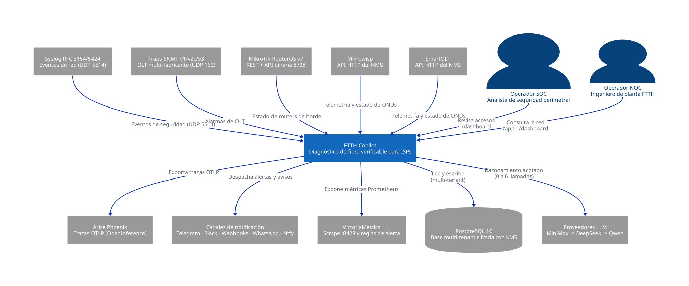
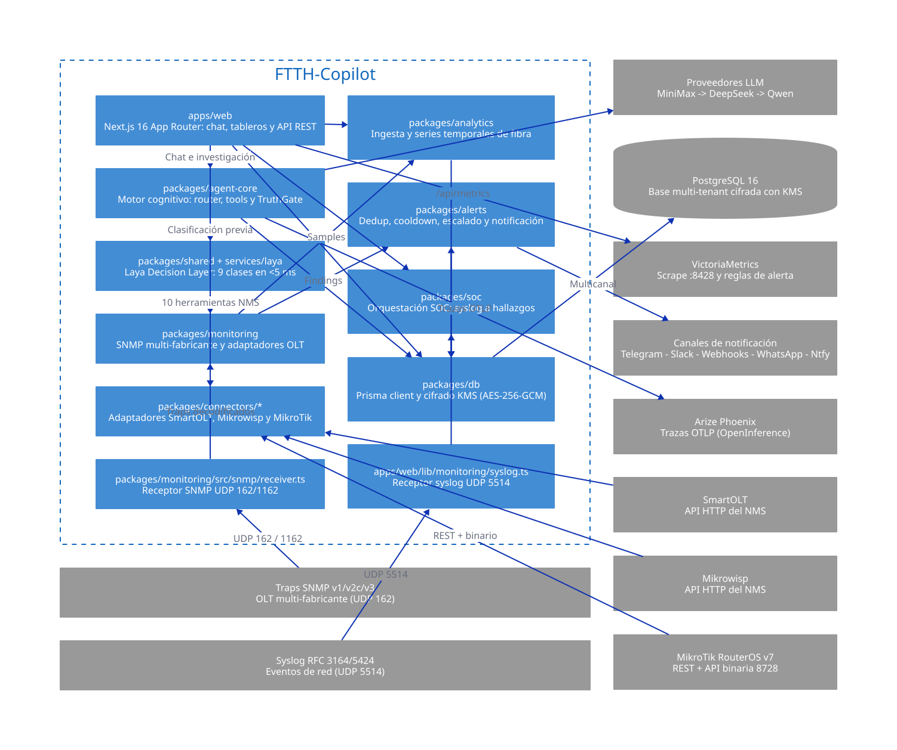
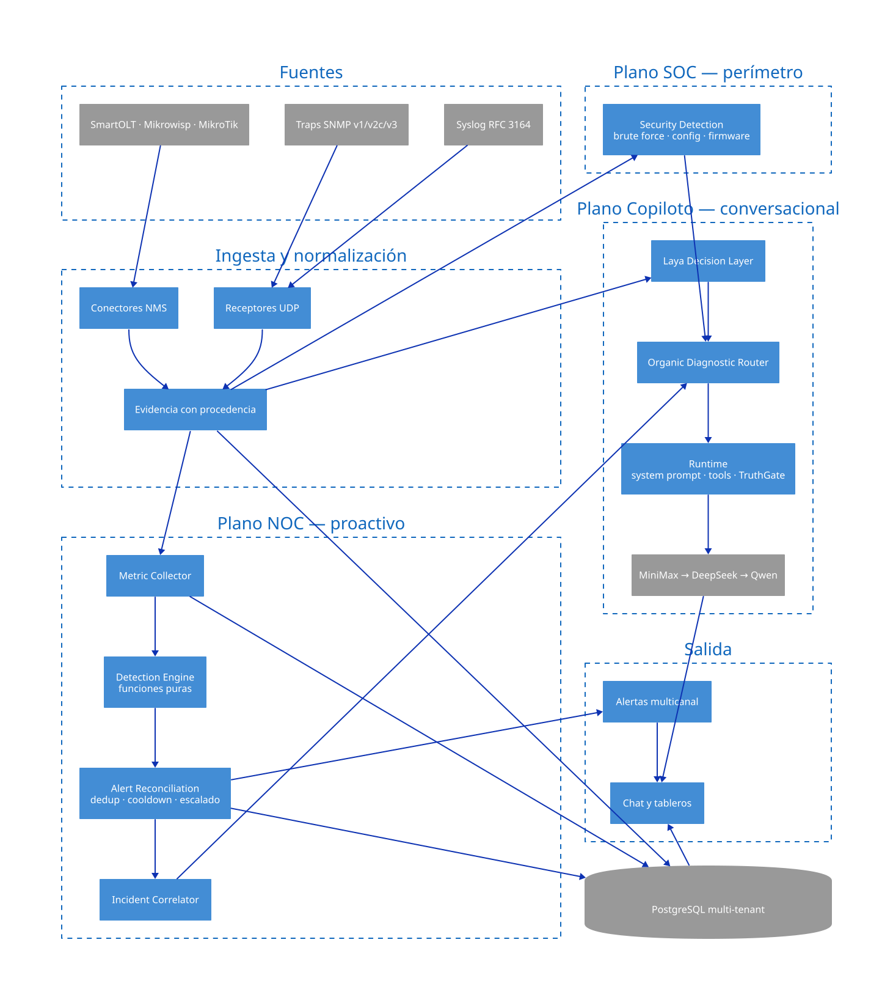

# FTTH-Copilot

**Diagnóstico de fibra para ISPs — impulsado por IA.**

FTTH-Copilot convierte la telemetría de la red (SmartOLT, Mikrowisp, MikroTik, traps SNMP y syslog) en un **diagnóstico verificable** para el operador NOC: qué ONUs se fueron offline, por qué, y cuál es el siguiente paso.


> **From network data to operational evidence.**

---

## Qué hace

Responde la pregunta que un operador NOC tiene cada noche a las 2 AM: *¿Cuáles ONUs se fueron offline, por qué, y qué hago ahora?*

| | |
|---|---|
| **A quién va dirigido** | Ingeniero NOC o técnico de planta de un ISP FTTH que opera SmartOLT o Mikrowisp |
| **Qué resuelve** | Identificación rápida de ONUs offline, correlación de patrones de corte, predicción de fibra a punto de caer |
| **Qué NO hace (v0.2.2)** | No ingiere traps SNMP en tiempo real · No detecta intrusiones SOC · No hace auditoría de firmware · No automatiza remediation |
| **Métrica de éxito** | Un evaluador configura el entorno demo y llega a un diagnóstico funcional en ≤ 5 minutos sin credenciales reales |

| Capacidad | Valor operativo |
|---|---|
| **Laya Decision Layer (ADR-042)** | Expert System de clasificación de eventos FTTH — 94.4% accuracy, <5ms, sin GPU. Shadow mode acumulando datos para futuro fine-tuning. |
| **Organic Diagnostic Router** | Selecciona el camino mínimo viable (`direct`, `assisted` o `investigation`) según la intención, el alcance y la evidencia necesaria. |
| **NOC y AIOps predictivo** | Detecta deriva óptica y térmica, estima tiempo hasta degradación y correlaciona incidentes por topología y tiempo. |
| **Telemetría OLT multi-vendor** | Normaliza traps SNMP v1/v2c/v3 mediante adaptadores por familia, con 17 fabricantes catalogados y 152 hechos OID verificados. |
| **SOC perimetral** | Analiza syslog, correlaciona accesos anómalos y registra vulnerabilidades de firmware con trazabilidad por tenant. |
| **Evidence-first diagnostics** | Conserva procedencia, frescura y calidad de cada señal; TruthGate rechaza afirmaciones que la evidencia no sostiene. |
| **Autenticación enterprise y MFA** | LDAP/Active Directory con mapeo de grupos a roles, OIDC documentado y TOTP (MFA) por usuario. |
| **Alertas multicanal** | Webhooks, Telegram, Slack (Block Kit), WhatsApp y Ntfy push, con deduplicación, cooldown y escalado por severidad. |

> [!NOTE]
> La plataforma incluye capacidades NOC/AIOps, SOC, SNMP multi-vendor y más. El primer mensaje público se enfoca en el diagnóstico offline-ONU porque es lo que un ISP puede evaluar inmediatamente. Consultá [`docs/product-wedge.md`](docs/product-wedge.md) para el alcance técnico completo.

---

## Por qué existe

En un NOC tradicional, la información necesaria para resolver un incidente suele quedar fragmentada entre el NMS, las series temporales, las alarmas, la topología y el conocimiento del operador. El problema no es la falta de datos: es el tiempo y la carga cognitiva necesarios para convertirlos en una decisión defendible.

FTTH-Copilot preserva la evidencia original, separa los hechos de las hipótesis y aplica controles de calidad antes de presentar un diagnóstico. El operador obtiene una ruta de investigación auditable sin ceder el control de la red ni habilitar remediaciones opacas.

La plataforma mantiene a la persona en el circuito: **investiga, explica y prioriza; no ejecuta cambios sobre la infraestructura física.**

---

<!-- Anclas explícitas: preservan los deep links entrantes desde ROADMAP.md
     después de mover el detalle a ARCHITECTURE.md. -->

<a id="copiloto-conversacional-organic-diagnostic-router"></a>

## Arquitectura

La arquitectura es **código**: un único modelo C4 en
[`docs/architecture/c4/model.d2`](docs/architecture/c4/model.d2) del que salen
las vistas que se renderizan en CI. Si el modelo cambia y las vistas no, el
build falla.

### Contexto de sistema



### Contenedores



### Flujo de datos



Cuatro invariantes cruzan todo el sistema: **tenant-aware** (todo toca `tenantId`), **evidence-first** (TruthGate rechaza lo que la evidencia no sostiene), **fail-open** (si Laya o el LLM fallan, el pipeline continúa) y **shadow mode first** (Laya registra su decisión antes de influir en el routing).

El mapa completo de módulos, límites y dependencias está en [`ARCHITECTURE.md`](ARCHITECTURE.md). La especificación de la arquitectura interactiva está en [`docs/architecture/ftth-copilot-architecture.html`](docs/architecture/ftth-copilot-architecture.html).

---

## Cómo levantarlo

### Opción A — Demo con Docker (1 comando)

Levanta el stack completo con datos sintéticos, sin credenciales reales de NMS:

```bash
./scripts/run-demo.sh
```

Cuando veas `✓ app`, abrí `http://localhost:3001` e iniciá sesión con `admin@ftth-copilot.local` / `demo12345`.

Para detener: `./scripts/run-demo.sh down`. Para reiniciar desde cero: `./scripts/run-demo.sh reset`.

> **[▶ Ver el walkthrough en video (37 s)](docs/assets/ftth-copilot-demo-16x9.mp4)** — dos casos del Organic Diagnostic Router contra datos sintéticos. El guion escrito está en [`docs/walkthrough.md`](docs/walkthrough.md).

### Opción B — Desarrollo local (3 comandos)

**Requisitos:** Node.js 22+, pnpm 11+, PostgreSQL 16+ (o Docker para levantarlo automáticamente).

```bash
pnpm install        # 1. dependencias del monorepo
pnpm run setup      # 2. asistente interactivo: .env, claves KMS/JWT, migraciones y seed
pnpm dev            # 3. servidor de desarrollo en http://localhost:3001
```

`pnpm run setup` imprime la contraseña de administrador en consola. En CI o aprovisionamiento sin terminal: `pnpm run setup -- --non-interactive`.

### Opción C — Producción

```bash
./install.sh
```

Instalador interactivo: valida Docker, genera `.env.prod` con permisos `0600` y claves maestras de 32 bytes, compila la imagen Next.js standalone con usuario no privilegiado, aplica migraciones y valida `/api/health` con fallo estricto. El runbook completo está en [`docs/production-deployment.md`](docs/production-deployment.md).

---

## Documentación

| Documento | Para qué |
|---|---|
| [`ARCHITECTURE.md`](ARCHITECTURE.md) | Mapa de módulos, límites de dependencia, flujo de datos y qué no se toca. |
| [`AGENTS.md`](AGENTS.md) | Comandos de build, test y lint; convenciones del repo; arquitectura resumida. |
| [`CONTRIBUTING.md`](CONTRIBUTING.md) | Proceso de contribución: Conventional Commits, commits atómicos, PRs chicas y revisiones. |
| [`SECURITY.md`](SECURITY.md) | Reporte privado de vulnerabilidades y límites de investigación segura. |
| [`docs/quickstart.md`](docs/quickstart.md) | Guía de inicio rápido con las tres opciones de entorno. |
| [`docs/architecture.md`](docs/architecture.md) | Modelo mental detallado, modelo de datos y pipelines. |
| [`docs/compatibility-matrix.md`](docs/compatibility-matrix.md) | Catálogo canónico de OIDs, perfiles OLT y niveles de conformidad. |
| [`docs/production-deployment.md`](docs/production-deployment.md) | Despliegue, backup, restore, observabilidad y runbook de emergencia. |
| [`docs/enterprise-auth.md`](docs/enterprise-auth.md) | LDAP/AD, OIDC, MFA TOTP y autenticación local. |
| [`docs/benchmarks.md`](docs/benchmarks.md) | Latencia de diagnóstico, rendimiento SNMP y métricas de piloto. |
| [`docs/testing-without-hardware.md`](docs/testing-without-hardware.md) | Cómo inyectar trampas SNMP y simular incidentes ópticos sin OLT físico. |
| [`ROADMAP.md`](ROADMAP.md) | Estado actual (Current / Validation / Next / Later) y lo que todavía no está validado. |
| [`CHANGELOG.md`](CHANGELOG.md) | Histórico de cambios, límites conocidos y notas de upgrade. |

<!-- Anclas explícitas: preservan los deep links entrantes desde ROADMAP.md
     después de mover el detalle a ARCHITECTURE.md. -->

<a id="conectores-canales-de-alerta-y-estado-de-integración"></a>
<a id="3-observabilidad-y-métricas"></a>

El detalle de integraciones y de observabilidad está en [`ARCHITECTURE.md` §5](ARCHITECTURE.md#5-conectores-y-cobertura-olt) y [`ARCHITECTURE.md` §6](ARCHITECTURE.md#6-observabilidad).

---

## Estado, licencia y contribución

| Plataforma | Formato | Estado |
|---|---|---|
| Web / Docker | Demo y despliegue productivo | ✅ Disponible para evaluación |
| Linux | `.deb` y AppImage | ✅ Generado y validado |
| Windows | `.msi` y NSIS `.exe` | ✅ Generado y ejecutado bajo Wine/Proton |
| Android | APK | ✅ Generado; unsigned, instalación manual |

Los instaladores están en [GitHub Releases](https://github.com/Rene-Kuhm/FTTH-Copilot/releases/tag/v0.2.2).

**FTTH-Copilot es software propietario.** El acceso público es para evaluación técnica: leer el código, correr el demo y los tests y solicitar una licencia escrita para uso en producción. No hay derecho a forkear, modificar ni redistribuir. Los términos completos están en [`LICENSE`](LICENSE).

- **Contribuir código:** leé [`CONTRIBUTING.md`](CONTRIBUTING.md) y abrí un issue antes de enviar cambios.
- **Reportar una vulnerabilidad:** seguí el proceso de divulgación privada de [`SECURITY.md`](SECURITY.md). No publiques información sensible en un issue.
- **Sesión técnica o licencia:** abrí un issue con la etiqueta `evaluation` o contactá al equipo.

Copyright © 2026 TecnoDespegue / René Kuhm.
