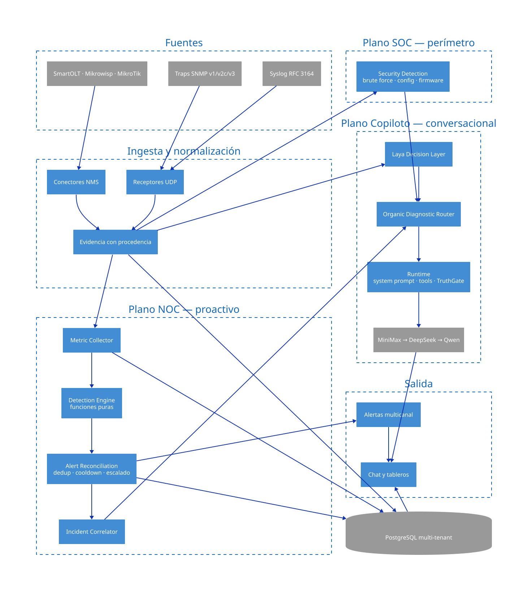
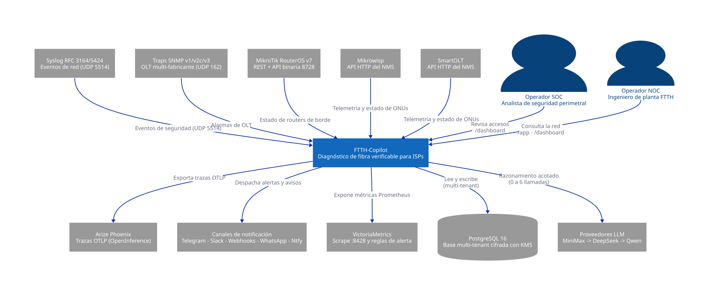
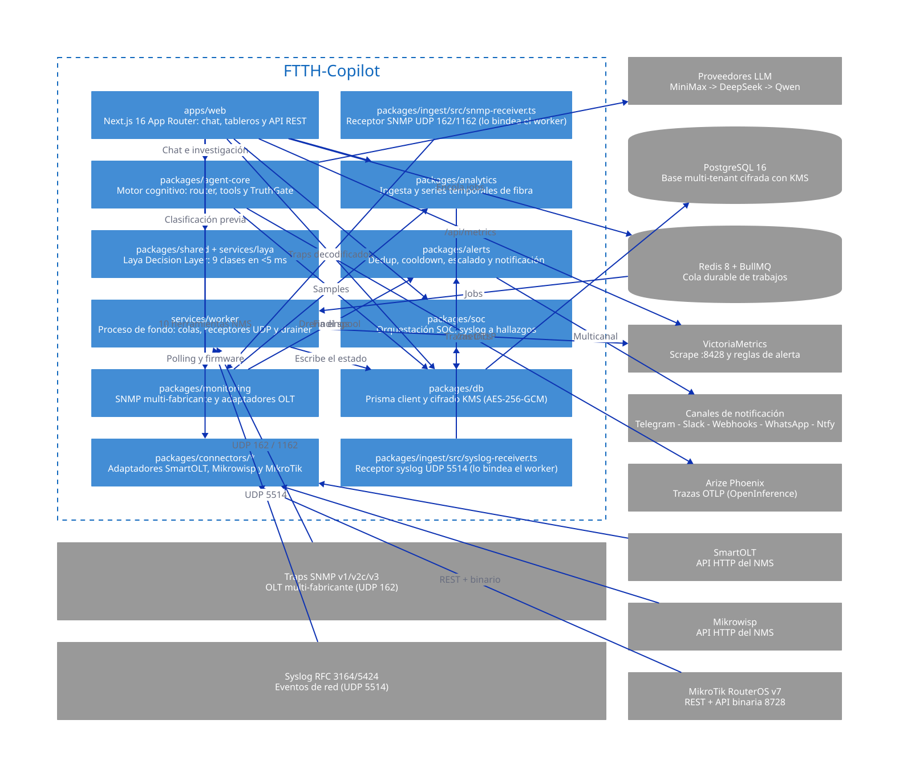
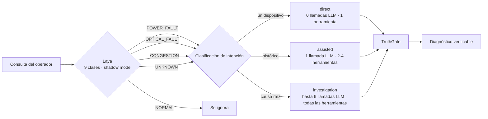
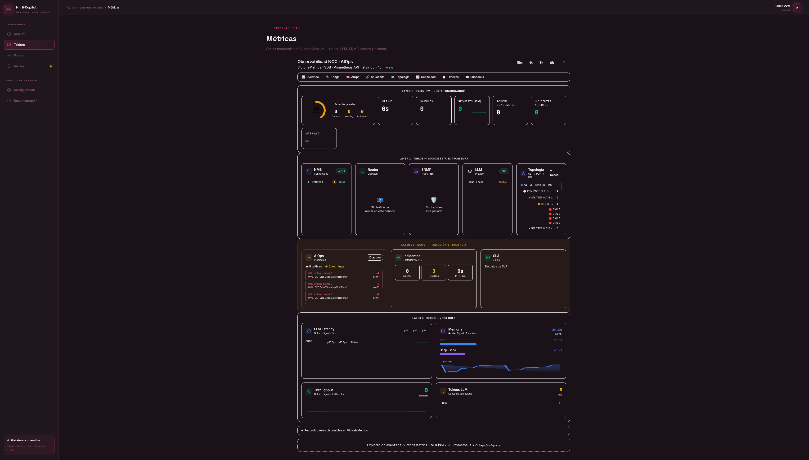

<a id="top"></a>

<div align="center">
  
</div>

<h1 align="center">FTTH-Copilot</h1>

<p align="center"><strong>Diagnóstico de fibra verificable para ISPs FTTH.</strong></p>

<p align="center">
  <a href="https://github.com/Rene-Kuhm/FTTH-Copilot/releases/latest"></a>
  <a href="https://github.com/Rene-Kuhm/FTTH-Copilot/actions/workflows/ci.yml"></a>
  <a href="https://github.com/Rene-Kuhm/FTTH-Copilot/actions/workflows/eval-nightly.yml"></a>
  <a href="LICENSE"></a>
  <a href="https://github.com/Rene-Kuhm/FTTH-Copilot/commits/main"></a>
</p>

<p align="center">
  
  
  
  
  
</p>

<p align="center">
  <strong>
    <a href="#que-hace">Qué hace</a>
    &nbsp;·&nbsp;
    <a href="#licencias-y-piloto">Licencias</a>
    &nbsp;·&nbsp;
    <a href="#como-funciona">Cómo funciona</a>
    &nbsp;·&nbsp;
    <a href="#plataforma">La plataforma</a>
    &nbsp;·&nbsp;
    <a href="#empezar">Empezar</a>
    &nbsp;·&nbsp;
    <a href="#documentacion">Documentación</a>
    &nbsp;·&nbsp;
    <a href="#english-summary">English</a>
  </strong>
</p>

<br>

<p align="center">La telemetría de tu red no llega como respuestas: llega como evidencia.<br><strong>FTTH-Copilot convierte SmartOLT, Mikrowisp, MikroTik, traps SNMP y syslog en un diagnóstico que un operador puede defender.</strong></p>

<div align="center">
  <h3>🎬 Verlo en acción</h3>

  <p>
  Dos casos del Organic Diagnostic Router contra datos sintéticos: 37 segundos, sin credenciales reales.
  </p>

  <p>
  <a href="docs/assets/ftth-copilot-demo-16x9.mp4"></a>
  </p>

  <p>
  <a href="docs/assets/ftth-copilot-demo-16x9.mp4">▶ Abrir el video (MP4, 37 s)</a> &nbsp;·&nbsp;
  <a href="docs/walkthrough.md">Leer el guion escrito</a>
  </p>
</div>

<p align="center"><strong>PLATAFORMA NOC/SOC</strong> &nbsp;·&nbsp; Evidencia primero &nbsp;·&nbsp; Multi-tenant &nbsp;·&nbsp; SNMP multi-vendor &nbsp;·&nbsp; Shadow mode</p>

<p align="right"><a href="#top">Volver arriba ↑</a></p>

<p align="center">— ◆ —</p>

<a id="que-hace"></a>

## 🎯 Qué hace

Responde la pregunta que un operador NOC tiene cada noche a las 2 AM: *¿Cuáles ONUs se fueron offline, por qué, y qué hago ahora?*

| | |
|---|---|
| **Estado de adopción** | Una empresa ya lo está probando |
| **A quién va dirigido** | Ingeniero NOC o técnico de planta de un ISP FTTH que opera SmartOLT, Mikrowisp o MikroTik |
| **Qué resuelve** | Identificación de ONUs offline, correlación de patrones de corte, predicción de fibra a punto de caer |
| **Qué NO hace** | No ejecuta cambios sobre la red · No es un reemplazo del NMS · No certifica todavía ninguna familia OLT en hardware real · No automatiza remediación |
| **Métrica de éxito** | Un evaluador configura el entorno demo y llega a un diagnóstico funcional en ≤ 5 minutos, sin credenciales reales |

| Capacidad | Valor operativo |
|---|---|
| **Laya Decision Layer** ([ADR-042](docs/engineering/ADR-042-laya-decision-layer.md)) | Expert System de clasificación de eventos FTTH: 9 clases por reglas y palabras clave, menos de 5 ms, sin GPU. Corre en shadow mode: registra su decisión antes de influir en el routing. Su tasa de acierto en campo todavía no está medida. |
| **Organic Diagnostic Router** | Elige el camino mínimo viable —`direct`, `assisted` o `investigation`— según la intención, el alcance y la evidencia necesaria. Una consulta puntual paga 0 llamadas al LLM. |
| **NOC y AIOps predictivo** | Detecta deriva óptica y térmica con detectores puros (mediana + MAD), estima el tiempo hasta degradación y correlaciona incidentes por topología y tiempo. |
| **Telemetría OLT multi-vendor** | Normaliza traps SNMP v1/v2c/v3 mediante adaptadores por familia: 17 fabricantes catalogados, 94 familias de hardware, 92 fuentes documentadas y 152 hechos OID verificados. |
| **SOC perimetral** | Analiza syslog RFC 3164/5424, correlaciona accesos anómalos y registra vulnerabilidades de firmware con trazabilidad por tenant. |
| **Evidence-first diagnostics** | Conserva procedencia, frescura y calidad de cada señal; el TruthGate rechaza las afirmaciones que la evidencia no sostiene. Abstener es un resultado correcto. |
| **Autenticación y MFA** | Login local con email y contraseña y segundo factor TOTP por usuario, implementados. LDAP/AD tiene cliente y diagnóstico, pero todavía no está conectado al flujo de login; OIDC/SSO está documentado y no implementado. |
| **Alertas multicanal** | Webhooks, Telegram, Slack (Block Kit), WhatsApp y Ntfy push, con deduplicación, cooldown y escalado por severidad. |

> [!NOTE]
> El producto tiene tres planos —copiloto conversacional, NOC/AIOps y SOC perimetral— sobre una sola base multi-tenant. El primer mensaje público se enfoca en el diagnóstico offline-ONU porque es lo que un ISP puede evaluar de inmediato. El alcance técnico completo está en [`docs/architecture.md`](docs/architecture.md); el [wedge original de v0.1.0](docs/product-wedge.md) describe el primer producto acotado y ya no refleja el estado actual.

<p align="right"><a href="#top">Volver arriba ↑</a></p>

<p align="center">— ◆ —</p>

<a id="licencias-y-piloto"></a>

## 📄 Licencias y piloto

FTTH-Copilot es software propietario. El acceso público es para revisión técnica; para ejecutarlo o usarlo en producción hace falta un permiso escrito del owner.

| Quiero… | Qué necesito |
|---|---|
| **Evaluar el producto** | Escribinos por cualquiera de los tres canales de abajo y contanos qué querés validar. |
| **Probar el demo** | Permiso escrito previo del owner. Mientras no esté definido en [`LICENSE`](LICENSE), hay que pedirlo. |
| **Desplegar en producción** | Firmar una licencia de uso con el owner. Sin licencia escrita, el despliegue no está autorizado. |
| **Evaluar un piloto en tu red** | Una licencia de evaluación para un tenant, con el alcance y la ventana acordados por escrito. |

**Contacto:** [contacto@tecnodespegue.com](mailto:contacto@tecnodespegue.com)

Podés iniciar por cualquiera de los dos canales:

1. **Por email** — a [contacto@tecnodespegue.com](mailto:contacto@tecnodespegue.com): contános qué querés validar y sobre qué tipo de red.
2. **Por issue** — con la etiqueta `evaluation`.

> [!CAUTION]
> **Los issues son públicos.** No publiques datos de tu red: ni IPs, ni identificadores de cliente, ni credenciales, ni capturas sin sanitizar. Contános solo el tipo de red y qué querés validar.

Te respondemos con el alcance de la evaluación y, si corresponde, con un permiso o una licencia de evaluación por escrito. Para producción, la licencia va firmada antes de usar la plataforma.

> El estado actual es **una empresa ya lo está probando**. El alcance de cada piloto lo acordamos por escrito: qué tenant, qué señales, qué ventana y qué queda fuera.

<p align="right"><a href="#top">Volver arriba ↑</a></p>

<p align="center">— ◆ —</p>

<a id="novedades"></a>

## ✨ Novedades en v0.7

La [release v0.7.0](https://github.com/Rene-Kuhm/FTTH-Copilot/releases/tag/v0.7.0) separa el trabajo de fondo del proceso web, y la v0.7.1 lo valida en staging:

- **El worker es el único dueño del trabajo de fondo.** *Breaking change:* el modo `embedded` se eliminó. Todo despliegue necesita el worker y Redis; `BACKEND_MODE=embedded` impide que la web arranque. Un deploy de la web ya no corta el monitoreo, y el tier web escala en horizontal sin duplicar trabajo. [Runbook](docs/how-to/desplegar-en-produccion.md).
- **El health de la web lista los loops del worker.** El endpoint de salud enumera los loops esperados y los receptores vigilados por su socket, y no se degrada tras un reinicio del worker.
- **Salvaguardas de la Fase 1 antes de aprender.** El learning loop verifica suficiencia de muestra y split temporal *antes* de congelar un dataset por tenant.
- **Un staging reproducible.** Levanta el entorno completo desde cero, con su base, sus migraciones y sus datos de prueba.
- **Rate limiter global de requests con Redis.** Límite por tenant o por IP, compartido entre instancias cuando hay `REDIS_URL` y con respaldo en memoria por proceso cuando no la hay. La cuota de LLM por usuario es un mecanismo aparte, en PostgreSQL.
- **Una sola tabla de version carriers.** La versión vive en un único lugar y los portadores se sincronizan desde ahí.

> El historial completo está en [`CHANGELOG.md`](CHANGELOG.md). Las entradas se generan con [release-please](https://github.com/googleapis/release-please) a partir de los Conventional Commits de `main`.

<p align="right"><a href="#top">Volver arriba ↑</a></p>

<p align="center">— ◆ —</p>

<a id="como-funciona"></a>

## 🧠 Cómo funciona

### Evidencia primero — De la telemetría al diagnóstico



La evidencia original se preserva, los hechos se separan de las hipótesis y los controles de calidad se aplican antes de presentar un diagnóstico. El operador recibe una ruta de investigación auditable, no una caja negra.

Cuatro invariantes atraviesan todo el sistema, y romperlas no es una cuestión de estilo: es un defecto.

| Invariante | Qué significa en código |
|---|---|
| **Tenant-aware** | Toda consulta, evento, clave de caché y referencia persistida lleva `tenantId`. No hay datos compartidos entre ISPs. |
| **Evidence first** | TruthGate rechaza afirmaciones que la evidencia no sostiene; abstener es un resultado válido, no un fallo. |
| **Fail-open** | Si Laya no responde, el pipeline continúa. Si el LLM falla, hay fallback. La degradación se registra, no se esconde. |
| **Shadow mode first** | Laya decide, pero solo registra hasta que la accuracy medida justifique que influya en el routing. |

**[Documento →](docs/explanation/evidencia-y-truth-gate.md)**

---

### Contexto de sistema



El sistema se apoya en lo que el ISP ya tiene: SmartOLT, Mikrowisp, MikroTik, un OLT que emite traps SNMP y el firewall que emite syslog. No reemplaza al NMS — lo consume. Lo único que agrega es la capa que convierte esas señales en un diagnóstico con procedencia.

La arquitectura es **código**: un único modelo C4 en [`docs/architecture/c4/model.d2`](docs/architecture/c4/model.d2) del que salen las cuatro vistas que se renderizan en CI. Si el modelo cambia y las vistas no, el build falla.

**[Documento →](docs/architecture.md)**

---

### Contenedores — 24 workspaces, dependencias hacia abajo



El monorepo es un workspace de pnpm con Turborepo: `apps/*`, `packages/*`, `packages/connectors/*` y `services/*`. Los paquetes se organizan en capas y **solo se importan hacia abajo**.

| Límite | Regla |
|---|---|
| **Dependencia** | Un paquete importa de su propia capa o de una inferior. Nunca hacia arriba, nunca en círculo. `apps/web` es el único que conoce a todos. |
| **Contratos** | Los esquemas Zod canónicos viven en `packages/shared`. Un tipo duplicado en dos paquetes es un bug, no una conveniencia. |
| **Detección** | `detection` y `security` exponen funciones **puras**: sin I/O, sin base, sin hora del sistema. Eso es lo que las hace testeables y auditables. |
| **Conectores** | Ningún adaptador habla directo con la base. Pasa por `connectors-core`, que es donde vive la política SSRF. |
| **Acceso a datos** | `db` es el único que conoce Prisma y el KMS. El resto consume el cliente tipado. |
| **Modelo de IA** | `agent-core` es el único que llama al LLM. Ningún endpoint de `apps/web` arma su propio prompt. |

Los **24 workspaces** y qué hace cada uno están en [`ARCHITECTURE.md` §2](ARCHITECTURE.md#2-mapa-de-módulos).

**[Documento →](ARCHITECTURE.md)**

---

<a id="copiloto-conversacional-organic-diagnostic-router"></a>

### Organic Diagnostic Router — Cuánto razona

El router clasifica cada consulta y decide **cuántas llamadas al LLM** se hacen y **qué herramientas** recibe el modelo. Antes de razonar, consulta a **Laya Decision Layer**, que clasifica el evento FTTH en menos de 5 ms y sin GPU.



| Modo | Llamadas LLM | Iteraciones máx. | Herramientas | Cuándo se usa |
|---|---|---|---|---|
| `direct` | **0** | 0 | 1 (la más específica) | Una sola herramienta responde la consulta. Ej.: `estado de ONU-342`. |
| `assisted` | **1** (o 2 si la primera emite tool call) | 1 | 2–4 | Pregunta con device ID, o consulta histórica. Ej.: `qué pasó ayer con ONU-342?` |
| `investigation` | **hasta 6** | 6 | todas | Multi-device, análisis de causa raíz, advisory. |

**Modos de Laya.** `shadow` (default) consulta al servicio y registra la decisión sin cambiar la ruta. `assisted` deja que la señal influya en el routing dentro de los umbrales de confianza. `automatic` permite que Laya elija la ruta. Los modos `assisted` y `automatic` necesitan `LAYA_URL` alcanzable; sin él, Laya degrada en fail-open y registra `fallback`.

**Cómo se mide.** Cada `runAgent` expone un campo `route` en `AgentResult` y un contador `ftth_copilot_router_dispatches_total{mode="..."}` en `/api/metrics`.

**[Documento →](docs/explanation/routing-y-laya.md)**

---

### TruthGate — Abstenerse es un resultado

El TruthGate es el último filtro. Una afirmación que la evidencia no sostiene no se muestra, no se suaviza y no se completa con suposiciones: el sistema se abstiene. Cada diagnóstico expone de dónde salió cada hecho, qué tan fresco es y qué calidad tiene.

Es la diferencia entre un copiloto que convence y uno que se puede auditar. Un operador que no puede explicar por qué el sistema dijo lo que dijo no lo va a usar en un incidente real.

**[Documento →](docs/explanation/evidencia-y-truth-gate.md)**

---

### Medido — Lo que el laboratorio dice, y lo que falta

**Medido en laboratorio** (conformance suite, sockets UDP de loopback y fixtures):

| Métrica | Valor | Condición | Umbral |
|---|---|---|---|
| **Tool call en modo `direct`** | **3 ms** | Fixture SmartOLT mock | 0 llamadas al LLM |
| **Latencia p95 SNMP** | **1,33 ms** | UDP loopback, conformance lab | < 50 ms ✅ |
| **Throughput SNMP sostenido** | **845 events/sec** | UDP loopback, conformance lab | > 100 events/sec ✅ |
| **Drops bajo carga sostenida** | **0** | UDP loopback, conformance lab | 0 requeridos ✅ |
| **Cobertura de detección** | **8/8** fault types | Tests pasando | 8/8 ✅ |

**Sin medir todavía.** No hay cifra, y no se inventa:

| Métrica | Umbral | Qué falta |
|---|---|---|
| **Afirmaciones sostenidas por evidencia** | ≥ 90% | Piloto con casos adjudicados por el operador. |
| **Falsos positivos de alerta** | < 5% | Piloto con tráfico real. |
| **Exactitud diagnóstica en campo** | — | Piloto con ground truth del operador. |
| **Reducción de esfuerzo del operador** | — | Línea de base comparable. |
| **Tiempo hasta la resolución** | — | Medición antes y después del piloto. |
| **Acierto de Laya contra `operatorOutcome`** | — | Corpus evaluado y dataset versionado en el repo. |
| **Precisión del clasificador de intención** | ≥ 0.95 (umbral, no medición) | Corpus con casos adjudicados por el operador. |

Una empresa ya está probando la plataforma, pero ese piloto todavía no produjo estas mediciones: el repo las marca como *TBD* en lugar de inventar una cifra. El harness adversarial corre todas las noches en CI con un gate de attack-pass-rate 100%.

**[Documento →](docs/benchmarks.md)**

<p align="right"><a href="#top">Volver arriba ↑</a></p>

<p align="center">— ◆ —</p>

<a id="plataforma"></a>

## 🖥️ La plataforma

Los tres planos comparten **una sola base multi-tenant**: no son aplicaciones separadas.

| Plano | Qué resuelve | Superficie operativa |
|---|---|---|
| **Copiloto conversacional** | Diagnósticos interactivos sobre estado de ONUs, causas de offline y consultas NMS. | `/app` (chat) y `/api/chat` |
| **NOC y AIOps cognitivo** | Predicción de derivas ópticas, cálculo de ETA a corte, hipótesis raíz. | `/dashboard` (Fallas) y `/api/predictions` |
| **SOC perimetral** | Detección de fuerza bruta, accesos tras fallos, auditoría de firmware con CVEs. | `/dashboard` (Accesos) y `/api/security/access` |



---

<a id="conectores-canales-de-alerta-y-estado-de-integración"></a>

### Conectores y canales de alerta

| Conector | Estado | Nota |
|---|---|---|
| **SmartOLT** | Integrado en runtime | API REST de producción y fixtures de laboratorio. |
| **Mikrowisp** | Integrado en runtime | API REST de producción y fixtures de laboratorio. |
| **MikroTik** | Integrado en runtime | RouterOS v7 por REST, con fallback a la API binaria 8728. |
| **NetSense** | Pendiente en roadmap | La API rechaza explícitamente la conexión sin sustituir datos con mocks silenciosos. |

| Canal | Estado | Nota |
|---|---|---|
| **Webhooks** | Integrado en runtime | Despacho automático de alertas tempranas e incidentes por tenant. |
| **Telegram** | Integrado en runtime | Despacho por bot token y chat id. |
| **Slack (Block Kit)** | Integrado en runtime | Bloques enriquecidos con barras de color por severidad. |
| **WhatsApp** | Integrado en runtime | Evolution / Z-API / Cloud API, texto Markdown y dispatch HTTP autenticado. |
| **Ntfy (self-hosted)** | Integrado en runtime | POST REST a `{serverUrl}/{topic}` con prioridad y tags. Sin Firebase ni costos. |

### Telemetría SNMP multi-vendor

El catálogo de compatibilidad OLT es un artefacto **generado**: [`docs/compatibility-matrix.md`](docs/compatibility-matrix.md) se reconstruye desde `research/olt/` con `pnpm generate:matrix:write`, y CI falla si deriva.

| Métrica | Valor |
|---|---|
| Fabricantes registrados | 17 |
| Familias de hardware | 94 |
| Fuentes documentadas | 92 |
| Hechos OID verificados | 152 |
| Familias en L1 (documentadas) | 72 |
| Familias en L2 (simuladas) | 22 |
| Familias en L3 / L4 (certificadas con hardware) | 0 / 0 — pendientes de la fase de validación |

Los decodificadores activos viven en `packages/monitoring/src/snmp/adapter/`: adaptadores por familia (Huawei, ZTE, Nokia, FiberHome, Calix, Adtran, VSOL, BDCOM, DZS, Ubiquiti), los perfiles estándar (RFC 2863 IF-MIB y xPON genérico ITU-T G.984/G.988) y el baseline open para equipos sin MIB público.

**[Documento →](docs/compatibility-matrix.md)**

<p align="right"><a href="#top">Volver arriba ↑</a></p>

<p align="center">— ◆ —</p>

<a id="3-observabilidad-y-métricas"></a>

## 📈 Observabilidad y métricas

| Pieza | Qué expone | Dónde |
|---|---|---|
| **Métricas Prometheus** | Proceso, SNMP, LLM, RAG, dispatches del router, decisiones de Laya | `/api/metrics` → scrape de VictoriaMetrics (`:8428`, VMUI incluida) |
| **VictoriaMetrics + reglas** | 8 recording rules y 7 alerting rules: caída de scrape, reinicios, caída del proveedor LLM de respaldo, colapso del modo `investigation` (>80% durante 15 min) | `docker/victoriametrics-alerts.yml`, evaluadas por VictoriaMetrics single-node o por el sidecar `vmalert` del stack de producción |
| **Phoenix LLM Tracing (OpenInference)** | Trazas de `agent.run`, `llm.*`, `retrieval.*`, `tool.*` e `investigation.engine`, con redactor estricto de secretos, exportadas como OTLP JSON a Arize Phoenix | `packages/agent-core/src/telemetry/` · exportador OTLP propio (sin SDK `@opentelemetry`) · `PHOENIX_COLLECTOR_ENDPOINT` |
| **Auditoría** | Registro de consultas, decisiones y evaluaciones | `packages/db` + `/dashboard` |

La UI de métricas en `/dashboard/metrics` muestra solicitudes totales, rendimiento del LLM, distribución de routing (direct / assisted / investigation) y la distribución de las 9 clases de decisión de Laya.

**[Documento →](docs/reference/configuracion.md)**

<p align="right"><a href="#top">Volver arriba ↑</a></p>

<p align="center">— ◆ —</p>

<a id="control"></a>

## 🛡️ Control

FTTH-Copilot mantiene a la persona en el circuito: **investiga, explica y prioriza; no ejecuta cambios sobre la infraestructura física.** No hay escrituras activas sobre la red —ni remediación SNMP, ni comandos a la OLT— y no las habrá sin una aprobación de diseño explícita.

| Control | Comportamiento |
|---|---|
| **Cifrado en reposo** | Claves de API y credenciales NMS con AES-256-GCM derivado de `KMS_MASTER_KEY`. En producción falla el arranque sin esa clave (`fail-closed`). |
| **Autenticación revocable** | Sesiones JWT en cookies `HttpOnly`, con invalidación y revocación atómica en PostgreSQL. |
| **Protección de costos LLM** | Cuota por usuario y por minuto, y cuota diaria estricta, con el contador atómico en PostgreSQL. Es la cuota de LLM: vive en la base y no tiene respaldo en memoria. |
| **Rate limiter de requests** | Límite global por tenant o por IP en Redis, compartido entre instancias cuando hay `REDIS_URL` y con respaldo en memoria por proceso cuando no la hay. Es un mecanismo aparte de la cuota de LLM. |
| **Protección SSRF en NMS** | Validación previa de DNS contra IPs privadas y metadatos de nube. Las excepciones LAN requieren opt-in explícito. |
| **Protección de base de datos** | El seed rechaza ejecutarse en producción salvo autorización explícita (`ALLOW_PRODUCTION_SEED=true` o flag `--force`). |
| **Aislamiento por tenant** | `tenantId` obligatorio en consultas, eventos, claves de caché y referencias persistidas. |
| **Modo demo** | `DEMO_MODE_ENABLED=true` solo en evaluación. La UI y el copiloto advierten que los datos son sintéticos. En producción debe permanecer en `false`. |

### Lo que este repositorio no toca sin una decisión explícita

Las migraciones aplicadas, el cliente Prisma generado, las fuentes MIB auditadas, la matriz de compatibilidad, el gate adversarial y los golden snapshots tienen dueño, propósito o una verificación de CI que los protege. La lista completa y cómo se verifica cada superficie están en [`ARCHITECTURE.md` §9](ARCHITECTURE.md#9-qué-no-se-toca-sin-una-decisión-explícita).

**[Documento →](ARCHITECTURE.md#9-qué-no-se-toca-sin-una-decisión-explícita)**

<p align="right"><a href="#top">Volver arriba ↑</a></p>

<p align="center">— ◆ —</p>

<a id="caja"></a>

## 📦 También viene en la caja

| Componente | Qué hace |
|---|---|
| **Organic Diagnostic Router** | Decide cuánto razona el modelo por consulta: 0, 1 o hasta 6 llamadas al LLM. |
| **Laya Decision Layer** | Expert System de 9 clases que clasifica el evento FTTH en menos de 5 ms, sin GPU, en shadow mode por defecto. |
| **TruthGate** | Último filtro: rechaza afirmaciones que la evidencia no sostiene y admite la abstención. |
| **Receptor SNMP multi-vendor** | Traps binarios v1/v2c/v3, deduplicación y token bucket, con 152 hechos OID verificados. |
| **Conectores SmartOLT, Mikrowisp y MikroTik** | Lectura de inventario y estado de ONUs desde el NMS que el ISP ya opera. |
| **Alertas multicanal** | Webhooks, Telegram, Slack, WhatsApp y Ntfy con deduplicación, cooldown y escalado. |
| **SOC perimetral** | Analizador syslog RFC 3164/5424, correlación de accesos anómalos y auditoría de firmware con CVEs. |
| **Auth local con MFA** | Login con email y contraseña y segundo factor TOTP por usuario. LDAP/AD está implementado como cliente y diagnóstico, todavía no conectado al flujo de login. |
| **Observabilidad** | Prometheus, VictoriaMetrics con reglas de alerta y trazas OTLP a Arize Phoenix. |
| **Laboratorio de conformidad** | Golden snapshots y sockets UDP de loopback: el suite SNMP pasa sin equipo físico. |
| **Harness adversarial** | Corpus con tenants piloto y gate de attack-pass-rate 100%, corrido nightly en CI. |
| **Learning loop** | Resolución de etiquetas, agrupación en eventos, split temporal y congelación de dataset por tenant. |
| **Empaquetado multiplataforma** | Web/Docker, escritorio Linux y Windows, y APK Android. |
| **Staging reproducible** | Un entorno completo que se levanta desde cero, con su base y sus datos de prueba. |

**Cada componente, comando y variable: [Referencia completa →](docs/reference/linea-de-comandos.md)**

### Plataformas

| Plataforma | Artefactos | Estado |
|---|---|---|
| **Web / Docker** | `Dockerfile`, `docker-compose.demo/prod/https/staging.yml`, `install.sh` | Disponible para evaluación. |
| **Linux desktop** | `.deb` y AppImage | Generados y validados en CI. |
| **Windows** | `.msi` y `.exe` (NSIS) | Generados; ejecutados bajo Wine/Proton. |
| **Android** | APK debug y APK release sin firmar | Generado; unsigned, instalación manual. |

Los binarios se publican en [GitHub Releases](https://github.com/Rene-Kuhm/FTTH-Copilot/releases).

<p align="right"><a href="#top">Volver arriba ↑</a></p>

<p align="center">— ◆ —</p>

<a id="empezar"></a>

## ⚡ Empezar

**¿Cuál camino es el tuyo?**

| Si… | Usá |
| :--- | :--- |
| Querés ver el producto funcionando ya, sin credenciales reales | [Opción A — Demo con Docker](#opción-a--demo-con-docker-1-comando) |
| Vas a tocar código | [Opción B — Desarrollo local](#opción-b--desarrollo-local-3-comandos) |
| Vas a desplegarlo en un servidor | [Opción C — Producción](#opción-c--producción) |

### Opción A — Demo con Docker (1 comando)

Levanta el stack completo con datos sintéticos. Requisitos: Docker y Docker Compose, y los puertos 5432 y 3001 libres.

> [!NOTE]
> Ejecutar el demo requiere el permiso escrito del owner: mientras no esté definido en [`LICENSE`](LICENSE), hay que pedirlo antes. [Ver cómo pedirlo →](#licencias-y-piloto)

```bash
./scripts/run-demo.sh
```

Cuando veas `✓ app`, abrí `http://localhost:3001` e iniciá sesión con `admin@ftth-copilot.local` / `demo12345`.

Para detener: `./scripts/run-demo.sh down`. Para reiniciar desde cero: `./scripts/run-demo.sh reset`.

**[Guía →](docs/tutorials/tutorial-1-el-demo-en-un-comando.md)**

### Opción B — Desarrollo local (3 comandos)

**Requisitos:** Node.js 22+, pnpm 11+, PostgreSQL 16+ (o Docker para levantarlo automáticamente).

> [!NOTE]
> Levantar el entorno local también es ejecutar el software: requiere el permiso escrito del owner, como el demo. [Ver cómo pedirlo →](#licencias-y-piloto)

```bash
pnpm install        # 1. dependencias del monorepo
pnpm run setup      # 2. asistente interactivo: .env, claves KMS/JWT, migraciones y seed
pnpm dev            # 3. servidor de desarrollo en http://localhost:3001
```

`pnpm run setup` imprime la contraseña de administrador en consola. En CI o aprovisionamiento sin terminal: `pnpm run setup -- --non-interactive`.

Antes de abrir un PR: `pnpm typecheck && pnpm lint && pnpm test`.

**[Guía →](docs/tutorials/tutorial-3-entorno-local.md)**

### Opción C — Producción

> [!WARNING]
> **El uso en producción requiere una licencia escrita.** El instalador no la incluye ni la sustituye: sin un acuerdo firmado con el owner, el despliegue no está autorizado. [Pedila acá](#licencias-y-piloto).

```bash
./install.sh
```

Instalador interactivo: valida Docker, genera `.env.prod` con permisos `0600` y claves maestras de 32 bytes, compila la imagen Next.js standalone con usuario no privilegiado, aplica migraciones y valida `/api/health` con fallo estricto.

El runbook completo —despliegue, backup, restore, observabilidad y emergencia— está en [`docs/production-deployment.md`](docs/production-deployment.md).

**[Guía de despliegue →](docs/how-to/desplegar-en-produccion.md)**

<p align="right"><a href="#top">Volver arriba ↑</a></p>

<p align="center">— ◆ —</p>

<a id="documentacion"></a>

## 📚 Documentación

Empezá por el destino que necesitás y bajá a la referencia operativa solo cuando haga falta.

| Destino | Para qué |
| :--- | :--- |
| [Guía de inicio rápido](docs/quickstart.md) | Los tres entornos de ejecución, paso a paso. |
| [Modelo mental](docs/architecture.md) | Pipelines, entidades y ciclo de vida de una alerta. |
| [Mapa del repositorio](ARCHITECTURE.md) | Qué módulos existen, qué puede depender de qué y qué no se toca. |
| [Cómo funciona, explicado](docs/explanation/README.md) | Evidencia y TruthGate, routing y Laya, topología y tenants, ciclo de vida de alertas. |
| [Cómo hacer algo](docs/how-to/README.md) | Conectar un NMS real, habilitar NOC y SOC, desplegar en staging o producción, backup y restore, probar sin hardware, agregar un OLT nuevo, agregar un endpoint de API. |
| [Referencia](docs/reference/README.md) | Línea de comandos, configuración, modelo de datos, API HTTP, contenedores y CI, mapa de paquetes. |
| [Tutoriales](docs/tutorials/README.md) | El demo en un comando, tu primera consulta, el entorno local, tu primera investigación. |
| [Matriz de compatibilidad OLT](docs/compatibility-matrix.md) | Catálogo canónico de OIDs, perfiles por familia y niveles de conformidad. |
| [ADRs](docs/adr/README.md) | Las decisiones de arquitectura y por qué se tomaron. |
| [Contrato de API](docs/contract/openapi.yaml) | Especificación OpenAPI de los endpoints HTTP. |
| [Autenticación enterprise](docs/enterprise-auth.md) | Autenticación local y MFA TOTP implementados; LDAP/AD, OIDC/SSO y los requisitos de MFA por entorno. |
| [Despliegue en producción](docs/production-deployment.md) | Despliegue, backup, restore, observabilidad y runbook de emergencia. |
| [Pruebas sin hardware](docs/testing-without-hardware.md) | Cómo inyectar traps SNMP y simular incidentes ópticos sin OLT físico. |
| [Benchmarks](docs/benchmarks.md) | Latencia de diagnóstico, rendimiento SNMP y métricas de piloto. |
| [Auditoría de seguridad](docs/security-audit.md) | Registro técnico de la auditoría de seguridad. |
| [Roadmap público](ROADMAP.md) | Qué está *Current*, qué necesita *Validation*, qué viene *Next* y qué queda *Later*. |
| [Changelog](CHANGELOG.md) | Histórico de cambios, límites conocidos y notas de upgrade. |

<p align="right"><a href="#top">Volver arriba ↑</a></p>

<p align="center">— ◆ —</p>

<a id="english-summary"></a>

## 🇬🇧 English summary

**What it is.** FTTH-Copilot turns the telemetry an ISP already has — SmartOLT, Mikrowisp, MikroTik, SNMP traps and syslog — into a verifiable diagnosis for a NOC operator: which ONUs went offline, why, and what to do next. It investigates, explains and prioritises; it never writes to the network.

**Current state.** A company is already trialling it. The platform ships three planes over one multi-tenant database (conversational copilot, NOC/AIOps, perimeter SOC), a multi-vendor SNMP receiver (17 vendors, 152 verified OID facts), a deterministic routing layer that decides how much the model reasons, and a truth gate that rejects any claim the evidence does not support. Field metrics are still `TBD`: no OLT family is certified on real hardware yet, and the trial has not published diagnostic-accuracy figures.

**Try the demo.** It ships with synthetic data, so no real credentials are needed. Running it still needs the owner's prior written permission — see the license note below.

```bash
./scripts/run-demo.sh
```

Then open `http://localhost:3001` and sign in with `admin@ftth-copilot.local` / `demo12345`.

**Request a license.** Production use requires a written license. Contact [contacto@tecnodespegue.com](mailto:contacto@tecnodespegue.com), or open an issue with the `evaluation` label. **Issues are public** — do not post network data: IPs, customer identifiers, credentials, or unsanitized captures. See [Licencias y piloto](#licencias-y-piloto).

**License.** Proprietary. Public access is for technical review: you may read the code and the published material. There is no right to fork, modify, redistribute, or run the software — the demo and the test suite included — without the owner's prior written permission. Until [`LICENSE`](LICENSE) defines that permission, request it in writing before running anything.

<p align="right"><a href="#top">Volver arriba ↑</a></p>

<p align="center">— ◆ —</p>

<a id="comunidad"></a>

## 🤝 Comunidad

FTTH-Copilot no es un proyecto open source. Podés reportar un bug, hacer una pregunta difícil o señalar documentación confusa: eso siempre es bienvenido. Las contribuciones de código siguen un proceso con **aprobación escrita previa** del owner, según [`CONTRIBUTING.md`](CONTRIBUTING.md).

<p align="center">
  <a href="https://github.com/Rene-Kuhm/FTTH-Copilot/issues"></a>
  <a href="https://github.com/Rene-Kuhm/FTTH-Copilot/graphs/contributors"></a>
  <a href="CHANGELOG.md"></a>
</p>

- Abrí un [issue](https://github.com/Rene-Kuhm/FTTH-Copilot/issues) con el contexto necesario para reproducir o entender la idea.
- Para proponer un cambio de código: abrí el issue, esperá el visto bueno por escrito y recién entonces mandá el PR. El formato es Conventional Commits 1.0.0, con commits atómicos y PRs chicas.
- Reportá una vulnerabilidad por el proceso de divulgación privada de [`SECURITY.md`](SECURITY.md). No publiques información sensible en un issue.

<p align="right"><a href="#top">Volver arriba ↑</a></p>

<p align="center">— ◆ —</p>

## Sobre el autor

FTTH-Copilot es obra de [René Kuhm](https://github.com/Rene-Kuhm), de TecnoDespegue. Creció de una convicción práctica: los agentes capaces son más útiles cuando la intención de la persona, la carga de revisión y el criterio de entrega siguen visibles durante todo el trabajo.

La plataforma mantiene esa línea hasta el final: el sistema investiga, explica y prioriza; la decisión operativa sigue siendo del operador.

<p align="center">
  <a href="https://github.com/Rene-Kuhm"></a>
  <a href="https://github.com/Rene-Kuhm/FTTH-Copilot/releases"></a>
  <a href="LICENSE"></a>
</p>

<p align="right"><a href="#top">Volver arriba ↑</a></p>

<p align="center">— ◆ —</p>

<p align="center"><strong>Software propietario. El acceso público es para revisión técnica.</strong></p>

> **FTTH-Copilot es software propietario.** El acceso público al repositorio es para revisión técnica: podés leer el código y el material publicado. No hay derecho a forkear, modificar, redistribuir ni a ejecutar el software sin permiso escrito previo del owner.
>
> Eso incluye correr el demo y los tests. Mientras [`LICENSE`](LICENSE) no defina ese permiso, **pedilo por escrito** antes de ejecutarlos; para usarlo en producción hace falta una licencia escrita.
>
> **Para pedir permiso o una licencia:** [contacto@tecnodespegue.com](mailto:contacto@tecnodespegue.com)
