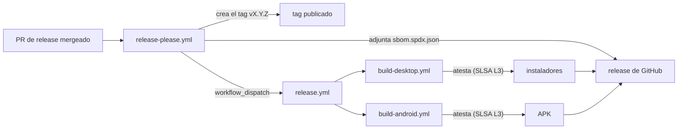

# Referencia de contenedores y CI

## 1. Imágenes

### `Dockerfile` raíz — 4 stages

| Stage | Base | Qué hace |
|---|---|---|
| `base` | `node:22-alpine` | pnpm 11.22.0 vía corepack, `libc6-compat`, `openssl` (`:6-12`) |
| `dependencies` | `base` | `pnpm install --frozen-lockfile` para `packages/` + `apps/` (`:15-27`) |
| `builder` | `base` | `ARG JWT_SECRET` **inlineado** en el bundle Edge (`:30`), `prisma generate`, `NEXT_OUTPUT_MODE=standalone` (`:32-45`) |
| `runner` | `node:22-alpine` | Usuario no-root `nextjs` (uid 1001), copia el schema de Prisma, el bundle standalone y `.next/static`. `EXPOSE 3001 1162/udp 5514/udp`, healthcheck `wget .../api/health`, `CMD ["node","apps/web/server.js"]` (`:48-76`) |

### `services/laya/Dockerfile`

`python:3.10-slim`, `pip install -r requirements.txt`, healthcheck en `/health`, `EXPOSE 8080`.

### `docker/snmp-lab/Dockerfile`

`alpine:3.20` + `net-snmp-tools`, con `MIBDIRS=/opt/snmp-lab/mibs` aislado y entrypoint
propio. Sirve para el laboratorio de conformidad.

## 2. `docker-compose.yml` — base de desarrollo

| Servicio | Imagen | Puertos | Volúmenes |
|---|---|---|---|
| `postgres` | `postgres:16-alpine` | `${POSTGRES_PORT:-5432}:5432` | `postgres_data` |
| `laya` | build `./services/laya` | `${LAYA_PORT:-8080}:8080` | — (profile `laya`) |

Healthchecks: `pg_isready` en postgres (`:28`), `curl /health` en laya (`:50`).

## 3. `docker-compose.demo.yml` — demo de un comando

| Servicio | Imagen | Puertos | Volúmenes |
|---|---|---|---|
| `postgres` | `postgres:16-alpine` | `${POSTGRES_PORT:-5432}:5432` | `postgres_demo_data` |
| `db-migrate` | build `.` target `dependencies` | — | — |
| `app` | build `.` target `runner` | `${PORT:-3001}:3001` | — |
| `victoriametrics` | `victoria-metrics:v1.153.0` | `${VICTORIAMETRICS_PORT:-8428}:8428` | `victoriametrics_demo_data`, entrypoint + scrape (ro) |
| `vmalert` | `vmalert:v1.153.0` | — | `docker/victoriametrics-alerts.yml` (ro) — profile `alerts` |
| `laya` | build `./services/laya` | `${LAYA_PORT:-8080}:8080` | — — profile `laya` |
| `ntfy` | `binwiederhier/ntfy:v3.3.0` | `${NTFY_PORT:-8125}:80` | `ntfy_cache` |
| `db-seed` | build `.` target `dependencies` | — | — |

Red `ftth-demo` (bridge).

Notas verificadas:

- El build de `app` requiere el build arg `JWT_SECRET` (`:86-132`).
- `app` conecta **directamente a Postgres**, no a PgBouncer: el pooler no es
  parte del compose de demo. Estaba ahí con una imagen que ya no existe en
  Docker Hub y su `depends_on` impedía que la app arrancara. La config queda
  en `docker/pgbouncer.ini` para quien quiera correrlo por su cuenta.
- `redis` exige `REDIS_PASSWORD`: sin ella el compose no interpola y no
  levanta (`:50`).
- `db-seed` necesita `SEED_ADMIN_PASSWORD`, `ALLOW_PRODUCTION_SEED=true` y
  `DEMO_DATA_ENABLED=true` (`:257-259`).

## 4. `docker-compose.prod.yml` — producción

| Servicio | Imagen | Puertos | Volúmenes |
|---|---|---|---|
| `postgres` | `postgres:16-alpine`, `env_file: .env.prod` | no publicados | `postgres_data` |
| `db-migrate` | build `.` target `dependencies` | — | — |
| `app` | build `.` target `runner`, imagen `ftth-copilot:latest` | `${PORT:-3001}:3001`, `${SNMP_UDP_PORT:-1162}:1162/udp`, `${SYSLOG_UDP_PORT:-5514}:5514/udp` | `spool_data:/var/lib/ftth-copilot/spool` |
| `laya` | build `./services/laya` | `${LAYA_PORT:-8080}:8080` | — — profile `laya` |
| `victoriametrics` | `victoria-metrics:v1.153.0` | `${VICTORIAMETRICS_PORT:-8428}:8428` | `victoriametrics_prod_data` |
| `vmalert` | `vmalert:v1.153.0` | — | `docker/victoriametrics-alerts.yml` (ro) |

Variables del contenedor `app` (`:44-55`): `NODE_ENV=production`, `PORT=3001`,
`EVENT_SPOOL_DIR=/var/lib/ftth-copilot/spool`, `SYSLOG_RECV_BUFFER_BYTES` (default
`4194304`), `LAYA_URL`.

Retención de VictoriaMetrics: 12 meses por defecto (`:130`). Red `ftth-network`. El bloque
de clúster HA de VictoriaMetrics está comentado (`:181-231`).

> `docker compose down -v` **borra el estado de producción**: el compose lo advierte
> explícitamente en `:238-249`.

## 5. `docker-compose.https.yml` — producción detrás de Caddy

| Servicio | Imagen | Puertos |
|---|---|---|
| `postgres` | `postgres:16-alpine`, `env_file: .env.prod` | no publicados |
| `db-migrate` | build `.` target `dependencies` | — |
| `app` | build `.` target `runner` | `expose: "3001"` (no publicado) |
| `caddy` | `caddy:2-alpine` | `${CADDY_HTTP_PORT:-80}:80`, `${CADDY_HTTPS_PORT:-443}:443` |

Caddy monta `Caddyfile.prod` (ro), con volúmenes `caddy_data` y `caddy_config`, y recibe
`CADDY_DOMAIN` (`:91`). El compose provisiona el certificado Let's Encrypt
automáticamente (`:1-14`).

## 6. PM2 — `ecosystem.config.cjs`

| App | Script | Entorno |
|---|---|---|
| `ftth-copilot` | `/bin/bash` + `apps/web/start.sh` (ruta absoluta del host) | `env_file: './apps/web/.env'`, `NODE_ENV=production` (`:26-39`) |
| `cloudflared` | `cloudflared tunnel --protocol http2 --no-autoupdate run` | `TUNNEL_TOKEN` leído del `.env` de la raíz, que nunca se commitea (`:40-49`) |

`cloudflared` tiene `restart_delay: 5000` y `max_restarts: 10` (`:47`).

## 7. systemd — `docker/vmbackup.service`

Sidecar `vmbackup` de VictoriaMetrics. `Type=oneshot`,
`ExecStart=/vmbackup-prod -storageDataPath=/storage -dest=${BACKUP_DEST:-file:///backups}`.
Variables: `BACKUP_INTERVAL`, `BACKUP_DEST`, `RETENTION_DAYS` (`:9-11`). Hay una plantilla de
timer systemd comentada (`:47-50`). Es el único `*.service` del repo.

## 8. Workflows de GitHub Actions

| Workflow | Triggers | Jobs |
|---|---|---|
| `ci.yml` | push a `main`, pull_request a `main`. Concurrencia `ci-${{ github.ref }}` con cancel-in-progress (`:29`) | `lint-and-typecheck` (`:47`) — lint, typecheck, `check:sources` + drift de matriz con `git diff --exit-code`, `check:conflicts`, `check:contribution`; `docs-test` (`:103`) — verificación zero-drift de la documentación + repo-map; `test-unit` (`:149`) — `pnpm test:coverage-check` + artefacto; `eval` (`:206`, `if: always()`) — harness de eval sin claves LLM; `build` (`:249`); `test-e2e` (`:289`) — Postgres 16, migraciones con `db:deploy`, seed, Playwright; `test-integration` (`:394`) — Postgres 16 + tests de `db` y `alerts`; `pr-title` (`:474`) — commitlint sobre el título de la PR; `supply-chain` (`:517`) — falla si una acción no está fijada por SHA, si un job no declara `permissions:` o si el pipeline de release está desconectado; `ci-success` (`:555`) — gate agregador |
| `codeql.yml` | push/PR a `main`, cron `23 7 * * 1` | `analyze` (`:19`) — `javascript-typescript`, `build-mode: none`, `queries: security-extended` |
| `eval-nightly.yml` | cron `0 3 * * *`, `workflow_dispatch` | `eval-nightly` (`:54`) — harness, lint, `metrics-report`, resumen con `attackPassRate`/`coverage`/`abstentionRate`/`gateFp`/`precision`/`schema`, subida de `packages/eval/reports/metrics-summary.json` (retención 90 días) |
| `quarterly-sources-audit.yml` | cron `0 0 1 */3 *`, `workflow_dispatch` | `sources-audit` (`:14`) — `check:sources`, `check:conflicts`, `check:contribution`, `check:sources:health --timeout=8000`, frescura de la matriz |
| `release-please.yml` | push a `main`, `workflow_dispatch` | `release` (`:65`) — release-please, sincroniza los version carriers, verifica la versión del tag y **despacha `release.yml`** (ver §9.4); `sbom` (`:230`) — adjunta el SBOM SPDX a la release (ver §9) |
| `release.yml` | tags `v*`, `workflow_dispatch` | `desktop` (`:58`) → `build-desktop.yml`; `android` (`:68`) → `build-android.yml`. Es el caller de release: concede los permisos de atestación y pasa el tag |
| `build-desktop.yml` | invocable (`workflow_call`) | `build-linux` (`:50`) — ubuntu-22.04, Rust estable, webkit2gtk, `pnpm build` + `pnpm tauri:prepare`, `tauri build --bundles deb,appimage`; `build-windows` (`:264`) — `--bundles nsis,msi`; `attach-to-release` (`:419`) — en modo release |
| `build-android.yml` | invocable (`workflow_call`) | `build` (`:36`) — Node 22, pnpm 11.22.0, JDK 21, Android SDK (platform-tools, android-34, build-tools 34.0.0), `cap sync`, `gradlew assembleDebug` + `assembleRelease`; `attach-to-release` (`:244`) — en modo release |
| `tauri-desktop.yml` | push a `main`/`tauri-desktop`, PR sobre `apps/web/**`, `apps/web/src-tauri/**` | `build-linux` (`:46`) y `build-windows` (`:88`) — usan la acción compuesta `desktop-build` en modo validación (sin atestación) |
| `android-apk.yml` | push a `main`/`design-system-v1`/`capacitor-android`, PR sobre `apps/web/**`, `apps/web/android/**` | `build` (`:45`) — usa la acción compuesta `android-build` en modo validación (sin atestación) |
| `.github/actions/android-build` | acción compuesta | `mise` + JDK 21 + Android SDK + `cap sync` + `gradlew assembleDebug`/`assembleRelease` |
| `.github/actions/desktop-build` | acción compuesta | `mise` + Rust estable + webkit2gtk (Linux) + `pnpm build` + `pnpm tauri:prepare` + `tauri build --bundles <bundles>` |

Entorno de CI: `mise` con versiones exactas (`MISE_VERSION=2026.10.12`, `mise.toml` + `mise.lock`). Ver
[§ entorno hermético](../engineering/hermetic-environment.md).

En el build de Tauri: `NEXT_PUBLIC_API_URL` (default `https://demo.ftth-copilot.com`) y
`NEXT_PUBLIC_PLATFORM=tauri`.

## 9. Supply chain y releases verificables

### 9.1 Acciones fijadas por SHA y permisos mínimos

- Toda acción de terceros se usa fijada por **SHA de commit**, nunca por tag ni
  por rama (un tag se puede mover; un SHA no). El comentario a la derecha de
  cada `uses:` deja el tag legible para el humano:
  `uses: actions/checkout@3d3c42e5aac5ba805825da76410c181273ba90b1 # v7.0.1`.
- Cada job declara su propio bloque `permissions:` con lo mínimo que necesita.
  El default del workflow es `contents: read`; lo que se necesita de más
  (`contents: write` para publicar releases, `security-events: write` para
  CodeQL, `id-token: write` + `attestations: write` para firmar) se pide de
  forma explícita y local.
- **El caller concede todo lo que pide el workflow reutilizable que llama.**
  GitHub valida el grafo del run antes de crear ningún job: si un workflow
  reutilizable declara un permiso que su caller no concede, el run entero
  muere con `startup_failure` y cero jobs — sin logs, y con la única evidencia
  en la anotación "Invalid workflow file" de la UI. El `if:` del job no
  protege, porque la validación mira lo declarado y no si el job llega a correr.
  Por eso el camino de validación **no llama** a los builders reutilizables:
  usa las acciones compuestas `.github/actions/android-build` y
  `.github/actions/desktop-build`, que compilan los mismos bytes sin pedir
  `id-token: write`. La regla `caller-permissions` de
  `scripts/lib/supply-chain.ts` verifica esta relación.
- **En un runner Windows, todo `run:` declara su shell** (en el step o en
  `defaults.run.shell`). Ahí el shell por defecto es `pwsh`, no `bash`: un
  script bash sin `shell:` muere con `ParserError` antes de ejecutar nada.
  Así se cayó el build de Windows de la v0.4.0 y, con él, el adjunto de todos
  los instaladores de escritorio. El job `build-windows` de
  `build-desktop.yml` declara `defaults.run.shell: bash`, y el único step
  PowerShell lo dice con `shell: pwsh`. La regla `windows-shell` lo verifica.
- El job `supply-chain` de `ci.yml` falla si alguien agrega una acción sin
  fijar, si un job no declara `permissions:`, si el pipeline de release queda
  desconectado, si un caller no concede lo que pide el workflow que llama
  (ver §9.4), si un step de Windows no declara su shell, si un attach no declara
  su tag (ver §9.4 bis) o si algún workflow reescribe el cuerpo de una release
  (ver §9.4 ter). Es hermético: sólo lee los YAML del repo. La
  política vive en `scripts/lib/supply-chain.ts` y se puede correr local:
  `pnpm check:supply-chain`.
- `.github/dependabot.yml` actualiza las acciones fijadas por SHA (cambia el
  SHA y el comentario de versión a la vez) y el lockfile del workspace pnpm
  (`versioning-strategy: lockfile-only`: los rangos de los `package.json` no se
  mueven).

### 9.2 Qué se puede verificar de una release

Cada release firmada con:

- **Procedencia (SLSA Build Level 3).** `actions/attest-build-provenance` emite la
  atestación de procedencia desde el runner hospedado por GitHub, con la
  identidad del builder atada al token OIDC del runner. Sin claves privadas en
  el repo y sin secretos que rotar.
- **SBOM.** `anchore/sbom-action` genera un SPDX 2.3 JSON del árbol publicado
  (Syft lee `pnpm-lock.yaml` y `Cargo.lock`, así que no hace falta instalar
  nada). `actions/attest-sbom` liga ese inventario al digest exacto de cada
  artefacto.
- **El SBOM adjunto a la release** como `sbom.spdx.json`.

### 9.3 Por qué el nivel es 3 y no 2

GitHub es explícito: *"Artifact attestations by itself provides SLSA v1.0
Build Level 2"*, y para llegar al 3 el build tiene que vivir en un workflow
reutilizable: *"Reusable workflows can provide isolation between the build
process and the calling workflow, to meet SLSA v1.0 Build Level 3"* (docs de
GitHub, *Artifact attestations*).

Por eso la estructura de release es:

| Rol | Workflow | Qué hace |
|---|---|---|
| Builder (workflow reutilizable) | `build-desktop.yml`, `build-android.yml` | Compila **y** atesta: emite la procedencia y el SBOM atestado sobre los bytes recién compilados |
| Caller | `release.yml` (tags `v*`) | Llama al builder y decide qué permisos concede |
| Validación | `tauri-desktop.yml`, `android-apk.yml` | Compilan con las acciones compuestas `desktop-build` / `android-build`, sin atestar y sin pedir token OIDC |

El caller sólo puede pasarle el tag al builder: no puede inyectar pasos en el
build. Ese es el aislamiento que da el nivel 3.

Los permisos tienen que estar de los dos lados, como pide la receta de GitHub:

```yaml
# en el caller (release.yml) y en el builder (build-*.yml)
permissions:
  attestations: write
  contents: write   # read alcanza para atestar; write para adjuntar a la release
  id-token: write
```

En el camino de validación (`tauri-desktop.yml`, `android-apk.yml`) **no**
aparece el builder reutilizable: se usa la acción compuesta equivalente
(`.github/actions/android-build`, `.github/actions/desktop-build`), que compila
los mismos bytes con `contents: read` y nada más. La razón es la validación
del grafo: un workflow reutilizable que pide `id-token: write` obliga a que
todo caller lo conceda, y entonces un pull request podría pedir un token
OIDC. Los pasos de atestación condicionados al modo release no sirven de
protección: GitHub rechaza el run **antes** de evaluarlos.

**Qué se atesta y qué no.** Se atesta lo que este repo compila: los
instaladores de escritorio (`.deb`, `.AppImage`, `.msi`, `.exe`) y los APK.
El archivo fuente de la release **no** se atesta: lo genera la API de GitHub
bajo demanda, no es el producto de ningún build, así que no hay un builder al
que atribuirle una procedencia. El SBOM sí se adjunta a la release: lo publica
`release-please.yml` con el mismo contenido byte a byte que atestan los
builders (por eso el digest del archivo publicado es el que llevan las
atestaciones).

Para verificar una release sin claves:

```bash
# 1) La procedencia: el signer es el workflow reutilizable que compiló
gh attestation verify app.deb --repo Rene-Kuhm/FTTH-Copilot \
  --signer-workflow Rene-Kuhm/FTTH-Copilot/.github/workflows/build-desktop.yml

# 2) El SBOM que se adjuntó a la release
gh release download v0.3.0 --pattern sbom.spdx.json
```

### 9.4 Cómo llega el build de release a correr

El circuito completo, de punta a punta:



El paso que no es obvio es el del medio. release-please crea el tag con el
`GITHUB_TOKEN` del repositorio, y GitHub **no** dispara workflows nuevos por
los eventos que produce su propio token (la regla de anti-recursión). O sea:
un `push: tags: v*` en `release.yml` no se dispararía, el build de release
quedaría sin ejecutar y la release se publicaría sin artefactos firmados.

La salida es `workflow_dispatch`, que es una de las dos excepciones
documentadas de esa regla (`repository_dispatch` es la otra): un dispatch
explícito abre un run nuevo aunque lo dispare el propio `GITHUB_TOKEN`. Es la
opción keyless — no hace falta un PAT ni una GitHub App — y por eso el job de
release pide `actions: write` y nada más.

El dispatch apunta al tag publicado, así que el builder compila exactamente los
bytes que se están por publicar. Y `release.yml` sigue siendo disparable a
mano desde la pestaña Actions, para reintentar sin republicar la release.

**El cable no se puede cortar en silencio.** `scripts/lib/supply-chain.ts`
verifica que el workflow que publica la release despacha al que atesta, y que
ese workflow acepta `workflow_dispatch`. Si alguien borra el dispatch, el
check falla y el CI se pone rojo.

### 9.4 bis El tag se declara siempre

Los binarios se adjuntan con `gh release upload`, que toma el tag como argumento:
si el tag no se declara, el paso no sabe a qué release subirlos. En el flujo
normal —release-please crea el tag y dispara el dispatch— el tag está a mano,
pero en el relanzamiento manual de una release ya publicada (el
`workflow_dispatch` de `release.yml` con `-f tag=v0.4.0`) `github.ref` es la
rama desde la que se despachó, no el tag.

Pasó con la v0.4.0: los tres builds compilaron bien y los dos attaches
fallaron.

El tag se declara en el `env:` del step y sale de una expresión del workflow
—el input del builder o el output de release-please—, nunca de un valor fijo:

```yaml
- name: Attach the binaries to the release
  env:
    GH_TOKEN: ${{ github.token }}
    TAG: ${{ inputs.release-tag }}
  run: |
    set -euo pipefail
    gh release upload "${TAG}" "${binaries[@]}" --clobber --repo "${GITHUB_REPOSITORY}"
```

La regla `attach-tag` de `scripts/lib/supply-chain.ts` falla el check de supply
chain si algún step que use `gh release upload` no declara el tag así. Se puede
correr local: `pnpm check:supply-chain`.

### 9.4 ter El attach no reescribe el cuerpo de la release

Las notas de una release publicada son de release-please: el changelog con las
entradas agrupadas por scope. Si el attach las vuelve a escribir, el cuerpo
queda con el mismo contenido repetido.

`softprops/action-gh-release` actualizaba la release antes de subir los
binarios, y con `generate_release_notes` le sumaba encima las notas que genera
GitHub. La v0.3.0 quedó con las notas de GitHub repetidas cuatro veces, una
por cada run que le adjuntó un artefacto.

Por eso el attach sube **assets y nada más**: `gh release upload` no toca el
cuerpo. La release se crea sólo cuando todavía no existe, y en ese caso es
`gh release create --generate-notes` la que le da cuerpo:

```yaml
- name: Create the release if it does not exist yet
  env:
    GH_TOKEN: ${{ github.token }}
    TAG: ${{ inputs.release-tag }}
  run: |
    set -euo pipefail
    if gh api "repos/${GITHUB_REPOSITORY}/releases/tags/${TAG}" >/dev/null 2>&1; then
      echo "The release ${TAG} already exists: its notes are left untouched."
    else
      gh release create "${TAG}" --repo "${GITHUB_REPOSITORY}" --title "${TAG}" --generate-notes
    fi
```

La regla `release-notes` de `scripts/lib/supply-chain.ts` falla el check de supply
chain si algún workflow vuelve a escribir el cuerpo de una release.

### 9.5 La línea base del changelog

release-please arma el changelog de cada release con los commits que encuentra
entre la línea base y `HEAD`. La línea base es el `last-release-sha` de
`release-please-config.json`.

La línea base tiene que apuntar al commit del último release publicado. Si
apunta a un commit más viejo, la release nueva repite las entradas del release
anterior y arrastra notas que ya se publicaron — un `BREAKING CHANGE:` de un
commit viejo, por ejemplo, que en la 0.4.0 anunciaba una incompatibilidad que
nunca existió.

`pnpm check:release-range` verifica esa relación contra el `CHANGELOG.md` que
se va a publicar:

- todo commit que aparece en la sección más reciente tiene que estar dentro
  del rango [línea base, `HEAD`];
- la sección más reciente no puede repetir una entrada de la sección anterior.

Es hermético —lee el changelog, el config y la historia del repo— y corre en el
CI, así que el pull request de release es el primero que ve el changelog
repetido, antes de que se publique.

La línea base actual es el merge del pull request #266, el último pull request
publicado en la `v0.3.0`. A partir de la `v0.4.0` el problema no se repite:
release-please publica cada release con el SHA del commit en
`target_commitish`, así que resuelve por su cuenta el último release y la
línea base queda como red de seguridad.

### 9.6 Token propio de release: el CI del PR de release sin intervención manual

Con el `GITHUB_TOKEN`, el PR de release es un caso raro: lo abre
release-please, así que sus runs de CI quedan en `action_required` y hay que
**aprobarlos a mano** en cada release. Como `main` exige el check
`CI Success` y la protección de la rama lo mira en el HEAD del PR, el PR
queda trabado hasta que alguien apruebe los runs.

La causa es la regla de anti-recursión: GitHub no dispara workflows por los
eventos que produce el `GITHUB_TOKEN` del propio repositorio. Un **token
propio** (un PAT) no está exento de esa regla, así que con él los eventos del
pipeline sí disparan workflows y el CI del PR de release corre solo.

El secret es **opcional**: sin él, todo funciona exactamente como hasta ahora
(keyless) y sólo hay que aprobar los runs a mano.

#### Cómo crearlo

1. Crear un **fine-grained PAT** (<https://github.com/settings/personal-access-tokens/new>):
   - **Repository access**: sólo `FTTH-Copilot`.
   - **Permissions → Repository permissions**: `Contents: Read and write`,
     `Pull requests: Read and write`, `Actions: Read and write`. Nada más.
   - **Expiration**: la más corta que sirva (90 días); se renueva a mano.
2. Guardarlo como secret del repositorio: **Settings → Secrets and variables →
   Actions → New repository secret**, nombre `RELEASE_PLEASE_TOKEN`.
3. Relanzar el workflow de release: `gh workflow run release-please.yml`.

Para volver atrás, borrar el secret: el pipeline vuelve a la ruta keyless.

> La alternativa de una **GitHub App** no está soportada por
> `release-please-action` v5: la acción no expone inputs de instalación de App
> y su documentación oficial señala el PAT como la vía para que el CI corra
> en los PRs de release.

#### Qué cambia cuando el secret existe

| Aspecto | Sin secret (keyless) | Con secret (PAT) |
|---|---|---|
| Token de release-please | `GITHUB_TOKEN` | el PAT |
| CI del PR de release | runs en `action_required`, hay que aprobarlos | corre solo |
| Build de la release | `workflow_dispatch` desde `release-please.yml` | el `push: tags` la dispara |
| Push de los version carriers | `GITHUB_TOKEN` (sus runs también hay que aprobarlos) | el PAT (dispara el CI del commit final) |

El segundo punto del push es el que suele pasarse por alto: el paso que
sincroniza los version carriers empuja a la rama del PR **después** de
release-please, y ese push es el que deja el PR en su commit final. Si empuja
con el `GITHUB_TOKEN`, sus runs vuelven a quedar en `action_required` y el
problema sigue ahí aunque release-please use el PAT.

#### La regla que lo ata

`scripts/lib/supply-chain.ts` tiene la regla `release-token-dispatch`: un
publicador que usa un token propio **tiene que condicionar su dispatch** a
que ese token no esté presente. Sin esa condición, el `push: tags` del builder
y el dispatch construirían la release dos veces (dos compilaciones, dos
atestaciones y el conflicto de los assets repetidos).

La condición no puede mirar el secret directamente —los secrets no se pueden
referenciar en un `if:`— así que pasa por una variable de `env:` de job:

```yaml
env:
  RELEASE_PLEASE_TOKEN: ${{ secrets.RELEASE_PLEASE_TOKEN }}
# ...
if: steps.release.outputs.release_created == 'true' && env.RELEASE_PLEASE_TOKEN == ''
```

#### El reset de los encabezados: por qué el push lleva dos `-c`

El push que sincroniza los version carriers tiene que empujar con el token
propio (es el push que deja el PR en su commit final, el que la protección de
la rama exige que tenga los checks). Y ahí hay un detalle de git que rompe
todo si se ignora:

`actions/checkout` persiste el `GITHUB_TOKEN` del job en
`http.https://github.com/.extraheader`. Git manda **un encabezado por cada
valor** de esa clave, y el valor de la línea de comandos no pisa al local: los
dos conviven. El valor vacío resetea la lista, y solo entonces gana el del
token propio:

```bash
git -c "http.https://github.com/.extraheader=" \
    -c "http.https://github.com/.extraheader=AUTHORIZATION: basic ${basic}" \
    push origin "HEAD:${branch}"
```

Verificado contra un servidor HTTP local que registra los encabezeros que
recibe:

| Configuración | Encabezado que llega |
|---|---|
| `-c` con el token propio | el del token propio ✓ |
| config del checkout **+** `-c` con el token propio | el del checkout ✗ (el token propio nunca se usa) |
| config del checkout **+ reset** **+** `-c` | el del token propio ✓ (uno solo) |

Sin el reset, el push empuja con la credencial del checkout —que es el
`GITHUB_TOKEN` del bot— en vez de con la propia: el push funciona, pero **no
dispara el CI** del PR de release, que es justo lo que el token propio tenía
que resolver.

La regla que lo ata es `release-token-headers`: el push que manda un
encabezado de autorización propio tiene que resetear la lista. Si alguien
saca el reset, `pnpm check:supply-chain` falla y el CI se pone rojo.

### 9.7 Los version carriers: una sola tabla

Un *version carrier* es un fichero que lleva la versión del release y que
`pnpm check:version` valida contra el tag publicado. Release-please actualiza
los `package.json`, el `tauri.conf.json` y el `Cargo.toml`; los demás los
actualiza el paso de sincronización de `release-please.yml`:

| Carrier | Versión |
|---|---|
| `apps/web/android/app/build.gradle` | `versionName` |
| `apps/web/app/api/health/route.ts` | el fallback del endpoint de health |
| `packages/agent-core/src/telemetry/exporter.ts` | el scope de telemetría |
| `packages/learning/src/version.ts` | la versión del núcleo de learning |

La lista vive en `scripts/lib/version-carriers.ts` y **la usan los dos**: el
check (`pnpm check:version`) y la sincronización (`pnpm sync:version-carriers`).
Un carrier nuevo está cubierto por los dos caminos con agregarlo una vez.

El paso de sincronización corre en **cada** ciclo del pipeline, no sólo cuando
release-please abre el pull request: un carrier que entra a `main` después de
que el PR de release se abrió queda desactualizado en el tag si el paso no
vuelve a correr. Pasó con `packages/learning/src/version.ts` (el núcleo de
learning entró en el 0.5.0): el tag salió con ese carrier en 0.4.0, la
verificación falló y la release quedó sin SBOM.

La regla `release-carriers` de `scripts/lib/supply-chain.ts` falla el check de
supply chain si el workflow que publica la release no llama a
`scripts/sync-version-carriers.ts`, o si lo llama antes de instalar las
dependencias (el script corre con el `tsx` del lockfile).

