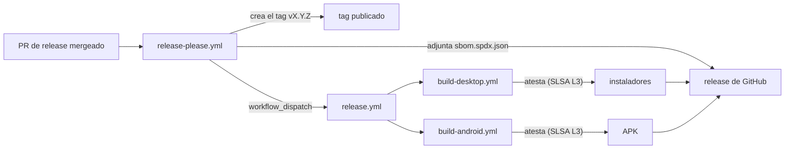

# Referencia de contenedores y CI

## 1. Imágenes

### `Dockerfile` raíz — 4 stages

| Stage | Base | Qué hace |
|---|---|---|
| `base` | `node:22-alpine` | pnpm 11.22.0 vía corepack, `libc6-compat`, `openssl` (`:6-12`) |
| `dependencies` | `base` | `pnpm install --frozen-lockfile` para `packages/` + `apps/` (`:15-27`) |
| `builder` | `base` | `ARG JWT_SECRET` **inlineado** en el bundle Edge (`:30`), `prisma generate`, `NEXT_OUTPUT_MODE=standalone` (`:32-45`) |
| `runner` | `node:22-alpine` | Usuario no-root `nextjs` (uid 1001), copia el schema de Prisma, el bundle standalone y `.next/static`. `EXPOSE 3001 1162/udp 5514/udp`, healthcheck `wget .../api/health`, `CMD ["node","apps/web/server.js"]` (`:48-76`) |

### `services/laya/Dockerfile`

`python:3.10-slim`, `pip install -r requirements.txt`, healthcheck en `/health`, `EXPOSE 8080`.

### `docker/snmp-lab/Dockerfile`

`alpine:3.20` + `net-snmp-tools`, con `MIBDIRS=/opt/snmp-lab/mibs` aislado y entrypoint
propio. Sirve para el laboratorio de conformidad.

## 2. `docker-compose.yml` — base de desarrollo

| Servicio | Imagen | Puertos | Volúmenes |
|---|---|---|---|
| `postgres` | `postgres:16-alpine` | `${POSTGRES_PORT:-5432}:5432` | `postgres_data` |
| `laya` | build `./services/laya` | `${LAYA_PORT:-8080}:8080` | — (profile `laya`) |

Healthchecks: `pg_isready` en postgres (`:28`), `curl /health` en laya (`:50`).

## 3. `docker-compose.demo.yml` — demo de un comando

| Servicio | Imagen | Puertos | Volúmenes |
|---|---|---|---|
| `postgres` | `postgres:16-alpine` | `${POSTGRES_PORT:-5432}:5432` | `postgres_demo_data` |
| `pgbouncer` | `edoburu/pgbouncer:1.24` | `${PGBOUNCER_PORT:-6432}:6432` | `docker/pgbouncer.ini`, `docker/pgbouncer-users.txt` (ro) |
| `db-migrate` | build `.` target `dependencies` | — | — |
| `app` | build `.` target `runner` | `${PORT:-3001}:3001` | — |
| `victoriametrics` | `victoria-metrics:v1.153.0` | `${VICTORIAMETRICS_PORT:-8428}:8428` | `victoriametrics_demo_data`, entrypoint + scrape (ro) |
| `vmalert` | `vmalert:v1.153.0` | — | `docker/victoriametrics-alerts.yml` (ro) — profile `alerts` |
| `laya` | build `./services/laya` | `${LAYA_PORT:-8080}:8080` | — — profile `laya` |
| `ntfy` | `binwiederhier/ntfy:v3.3.0` | `${NTFY_PORT:-8125}:80` | `ntfy_cache` |
| `db-seed` | build `.` target `dependencies` | — | — |

Red `ftth-demo` (bridge).

Notas verificadas:

- El build de `app` requiere el build arg `JWT_SECRET` (`:86-132`).
- `app` conecta **directamente a Postgres**, no a PgBouncer: la imagen de PgBouncer ya no
  está en Docker Hub (`:110-118`).
- `db-seed` necesita `SEED_ADMIN_PASSWORD`, `ALLOW_PRODUCTION_SEED=true` y
  `DEMO_DATA_ENABLED=true` (`:257-259`).

## 4. `docker-compose.prod.yml` — producción

| Servicio | Imagen | Puertos | Volúmenes |
|---|---|---|---|
| `postgres` | `postgres:16-alpine`, `env_file: .env.prod` | no publicados | `postgres_data` |
| `db-migrate` | build `.` target `dependencies` | — | — |
| `app` | build `.` target `runner`, imagen `ftth-copilot:latest` | `${PORT:-3001}:3001`, `${SNMP_UDP_PORT:-1162}:1162/udp`, `${SYSLOG_UDP_PORT:-5514}:5514/udp` | `spool_data:/var/lib/ftth-copilot/spool` |
| `laya` | build `./services/laya` | `${LAYA_PORT:-8080}:8080` | — — profile `laya` |
| `victoriametrics` | `victoria-metrics:v1.153.0` | `${VICTORIAMETRICS_PORT:-8428}:8428` | `victoriametrics_prod_data` |
| `vmalert` | `vmalert:v1.153.0` | — | `docker/victoriametrics-alerts.yml` (ro) |

Variables del contenedor `app` (`:44-55`): `NODE_ENV=production`, `PORT=3001`,
`EVENT_SPOOL_DIR=/var/lib/ftth-copilot/spool`, `SYSLOG_RECV_BUFFER_BYTES` (default
`4194304`), `LAYA_URL`.

Retención de VictoriaMetrics: 12 meses por defecto (`:130`). Red `ftth-network`. El bloque
de clúster HA de VictoriaMetrics está comentado (`:181-231`).

> `docker compose down -v` **borra el estado de producción**: el compose lo advierte
> explícitamente en `:238-249`.

## 5. `docker-compose.https.yml` — producción detrás de Caddy

| Servicio | Imagen | Puertos |
|---|---|---|
| `postgres` | `postgres:16-alpine`, `env_file: .env.prod` | no publicados |
| `db-migrate` | build `.` target `dependencies` | — |
| `app` | build `.` target `runner` | `expose: "3001"` (no publicado) |
| `caddy` | `caddy:2-alpine` | `${CADDY_HTTP_PORT:-80}:80`, `${CADDY_HTTPS_PORT:-443}:443` |

Caddy monta `Caddyfile.prod` (ro), con volúmenes `caddy_data` y `caddy_config`, y recibe
`CADDY_DOMAIN` (`:91`). El compose provisiona el certificado Let's Encrypt
automáticamente (`:1-14`).

## 6. PM2 — `ecosystem.config.cjs`

| App | Script | Entorno |
|---|---|---|
| `ftth-copilot` | `/bin/bash` + `apps/web/start.sh` (ruta absoluta del host) | `env_file: './apps/web/.env'`, `NODE_ENV=production` (`:26-39`) |
| `cloudflared` | `cloudflared tunnel --protocol http2 --no-autoupdate run` | `TUNNEL_TOKEN` leído del `.env` de la raíz, que nunca se commitea (`:40-49`) |

`cloudflared` tiene `restart_delay: 5000` y `max_restarts: 10` (`:47`).

## 7. systemd — `docker/vmbackup.service`

Sidecar `vmbackup` de VictoriaMetrics. `Type=oneshot`,
`ExecStart=/vmbackup-prod -storageDataPath=/storage -dest=${BACKUP_DEST:-file:///backups}`.
Variables: `BACKUP_INTERVAL`, `BACKUP_DEST`, `RETENTION_DAYS` (`:9-11`). Hay una plantilla de
timer systemd comentada (`:47-50`). Es el único `*.service` del repo.

## 8. Workflows de GitHub Actions

| Workflow | Triggers | Jobs |
|---|---|---|
| `ci.yml` | push a `main`, pull_request a `main`. Concurrencia `ci-${{ github.ref }}` con cancel-in-progress (`:29`) | `lint-and-typecheck` (`:47`) — lint, typecheck, `check:sources` + drift de matriz con `git diff --exit-code`, `check:conflicts`, `check:contribution`; `docs-test` (`:103`) — verificación zero-drift de la documentación + repo-map; `test-unit` (`:149`) — `pnpm test:coverage-check` + artefacto; `eval` (`:206`, `if: always()`) — harness de eval sin claves LLM; `build` (`:249`); `test-e2e` (`:289`) — Postgres 16, migraciones con `db:deploy`, seed, Playwright; `test-integration` (`:394`) — Postgres 16 + tests de `db` y `alerts`; `pr-title` (`:474`) — commitlint sobre el título de la PR; `supply-chain` (`:517`) — falla si una acción no está fijada por SHA, si un job no declara `permissions:` o si el pipeline de release está desconectado; `ci-success` (`:555`) — gate agregador |
| `codeql.yml` | push/PR a `main`, cron `23 7 * * 1` | `analyze` (`:19`) — `javascript-typescript`, `build-mode: none`, `queries: security-extended` |
| `eval-nightly.yml` | cron `0 3 * * *`, `workflow_dispatch` | `eval-nightly` (`:54`) — harness, lint, `metrics-report`, resumen con `attackPassRate`/`coverage`/`abstentionRate`/`gateFp`/`precision`/`schema`, subida de `packages/eval/reports/metrics-summary.json` (retención 90 días) |
| `quarterly-sources-audit.yml` | cron `0 0 1 */3 *`, `workflow_dispatch` | `sources-audit` (`:14`) — `check:sources`, `check:conflicts`, `check:contribution`, `check:sources:health --timeout=8000`, frescura de la matriz |
| `release-please.yml` | push a `main`, `workflow_dispatch` | `release` (`:65`) — release-please, sincroniza los version carriers, verifica la versión del tag y **despacha `release.yml`** (ver §9.4); `sbom` (`:230`) — adjunta el SBOM SPDX a la release (ver §9) |
| `release.yml` | tags `v*`, `workflow_dispatch` | `desktop` (`:58`) → `build-desktop.yml`; `android` (`:68`) → `build-android.yml`. Es el caller de release: concede los permisos de atestación y pasa el tag |
| `build-desktop.yml` | invocable (`workflow_call`) | `build-linux` (`:50`) — ubuntu-22.04, Rust estable, webkit2gtk, `pnpm build` + `pnpm tauri:prepare`, `tauri build --bundles deb,appimage`; `build-windows` (`:264`) — `--bundles nsis,msi`; `attach-to-release` (`:419`) — en modo release |
| `build-android.yml` | invocable (`workflow_call`) | `build` (`:36`) — Node 22, pnpm 11.22.0, JDK 21, Android SDK (platform-tools, android-34, build-tools 34.0.0), `cap sync`, `gradlew assembleDebug` + `assembleRelease`; `attach-to-release` (`:244`) — en modo release |
| `tauri-desktop.yml` | push a `main`/`tauri-desktop`, PR sobre `apps/web/**`, `apps/web/src-tauri/**` | `build-linux` (`:46`) y `build-windows` (`:88`) — usan la acción compuesta `desktop-build` en modo validación (sin atestación) |
| `android-apk.yml` | push a `main`/`design-system-v1`/`capacitor-android`, PR sobre `apps/web/**`, `apps/web/android/**` | `build` (`:45`) — usa la acción compuesta `android-build` en modo validación (sin atestación) |
| `.github/actions/android-build` | acción compuesta | `mise` + JDK 21 + Android SDK + `cap sync` + `gradlew assembleDebug`/`assembleRelease` |
| `.github/actions/desktop-build` | acción compuesta | `mise` + Rust estable + webkit2gtk (Linux) + `pnpm build` + `pnpm tauri:prepare` + `tauri build --bundles <bundles>` |

Entorno de CI: `mise` con versiones exactas (`MISE_VERSION=2026.10.12`, `mise.toml` + `mise.lock`). Ver
[§ entorno hermético](../engineering/hermetic-environment.md).

En el build de Tauri: `NEXT_PUBLIC_API_URL` (default `https://demo.ftth-copilot.com`) y
`NEXT_PUBLIC_PLATFORM=tauri`.

## 9. Supply chain y releases verificables

### 9.1 Acciones fijadas por SHA y permisos mínimos

- Toda acción de terceros se usa fijada por **SHA de commit**, nunca por tag ni
  por rama (un tag se puede mover; un SHA no). El comentario a la derecha de
  cada `uses:` deja el tag legible para el humano:
  `uses: actions/checkout@3d3c42e5aac5ba805825da76410c181273ba90b1 # v7.0.1`.
- Cada job declara su propio bloque `permissions:` con lo mínimo que necesita.
  El default del workflow es `contents: read`; lo que se necesita de más
  (`contents: write` para publicar releases, `security-events: write` para
  CodeQL, `id-token: write` + `attestations: write` para firmar) se pide de
  forma explícita y local.
- **El caller concede todo lo que pide el workflow reutilizable que llama.**
  GitHub valida el grafo del run antes de crear ningún job: si un workflow
  reutilizable declara un permiso que su caller no concede, el run entero
  muere con `startup_failure` y cero jobs — sin logs, y con la única evidencia
  en la anotación "Invalid workflow file" de la UI. El `if:` del job no
  protege, porque la validación mira lo declarado y no si el job llega a correr.
  Por eso el camino de validación **no llama** a los builders reutilizables:
  usa las acciones compuestas `.github/actions/android-build` y
  `.github/actions/desktop-build`, que compilan los mismos bytes sin pedir
  `id-token: write`. La regla `caller-permissions` de
  `scripts/lib/supply-chain.ts` verifica esta relación.
- El job `supply-chain` de `ci.yml` falla si alguien agrega una acción sin
  fijar, si un job no declara `permissions:`, si el pipeline de release queda
  desconectado o si un caller no concede lo que pide el workflow que llama
  (ver §9.4). Es hermético: sólo lee los YAML del repo. La
  política vive en `scripts/lib/supply-chain.ts` y se puede correr local:
  `pnpm check:supply-chain`.
- `.github/dependabot.yml` actualiza las acciones fijadas por SHA (cambia el
  SHA y el comentario de versión a la vez) y el lockfile del workspace pnpm
  (`versioning-strategy: lockfile-only`: los rangos de los `package.json` no se
  mueven).

### 9.2 Qué se puede verificar de una release

Cada release firmada con:

- **Procedencia (SLSA Build Level 3).** `actions/attest-build-provenance` emite la
  atestación de procedencia desde el runner hospedado por GitHub, con la
  identidad del builder atada al token OIDC del runner. Sin claves privadas en
  el repo y sin secretos que rotar.
- **SBOM.** `anchore/sbom-action` genera un SPDX 2.3 JSON del árbol publicado
  (Syft lee `pnpm-lock.yaml` y `Cargo.lock`, así que no hace falta instalar
  nada). `actions/attest-sbom` liga ese inventario al digest exacto de cada
  artefacto.
- **El SBOM adjunto a la release** como `sbom.spdx.json`.

### 9.3 Por qué el nivel es 3 y no 2

GitHub es explícito: *"Artifact attestations by itself provides SLSA v1.0
Build Level 2"*, y para llegar al 3 el build tiene que vivir en un workflow
reutilizable: *"Reusable workflows can provide isolation between the build
process and the calling workflow, to meet SLSA v1.0 Build Level 3"* (docs de
GitHub, *Artifact attestations*).

Por eso la estructura de release es:

| Rol | Workflow | Qué hace |
|---|---|---|
| Builder (workflow reutilizable) | `build-desktop.yml`, `build-android.yml` | Compila **y** atesta: emite la procedencia y el SBOM atestado sobre los bytes recién compilados |
| Caller | `release.yml` (tags `v*`) | Llama al builder y decide qué permisos concede |
| Validación | `tauri-desktop.yml`, `android-apk.yml` | Compilan con las acciones compuestas `desktop-build` / `android-build`, sin atestar y sin pedir token OIDC |

El caller sólo puede pasarle el tag al builder: no puede inyectar pasos en el
build. Ese es el aislamiento que da el nivel 3.

Los permisos tienen que estar de los dos lados, como pide la receta de GitHub:

```yaml
# en el caller (release.yml) y en el builder (build-*.yml)
permissions:
  attestations: write
  contents: write   # read alcanza para atestar; write para adjuntar a la release
  id-token: write
```

En el camino de validación (`tauri-desktop.yml`, `android-apk.yml`) **no**
aparece el builder reutilizable: se usa la acción compuesta equivalente
(`.github/actions/android-build`, `.github/actions/desktop-build`), que compila
los mismos bytes con `contents: read` y nada más. La razón es la validación
del grafo: un workflow reutilizable que pide `id-token: write` obliga a que
todo caller lo conceda, y entonces un pull request podría pedir un token
OIDC. Los pasos de atestación condicionados al modo release no sirven de
protección: GitHub rechaza el run **antes** de evaluarlos.

**Qué se atesta y qué no.** Se atesta lo que este repo compila: los
instaladores de escritorio (`.deb`, `.AppImage`, `.msi`, `.exe`) y los APK.
El archivo fuente de la release **no** se atesta: lo genera la API de GitHub
bajo demanda, no es el producto de ningún build, así que no hay un builder al
que atribuirle una procedencia. El SBOM sí se adjunta a la release: lo publica
`release-please.yml` con el mismo contenido byte a byte que atestan los
builders (por eso el digest del archivo publicado es el que llevan las
atestaciones).

Para verificar una release sin claves:

```bash
# 1) La procedencia: el signer es el workflow reutilizable que compiló
gh attestation verify app.deb --repo Rene-Kuhm/FTTH-Copilot \
  --signer-workflow Rene-Kuhm/FTTH-Copilot/.github/workflows/build-desktop.yml

# 2) El SBOM que se adjuntó a la release
gh release download v0.3.0 --pattern sbom.spdx.json
```

### 9.4 Cómo llega el build de release a correr

El circuito completo, de punta a punta:



El paso que no es obvio es el del medio. release-please crea el tag con el
`GITHUB_TOKEN` del repositorio, y GitHub **no** dispara workflows nuevos por
los eventos que produce su propio token (la regla de anti-recursión). O sea:
un `push: tags: v*` en `release.yml` no se dispararía, el build de release
quedaría sin ejecutar y la release se publicaría sin artefactos firmados.

La salida es `workflow_dispatch`, que es una de las dos excepciones
documentadas de esa regla (`repository_dispatch` es la otra): un dispatch
explícito abre un run nuevo aunque lo dispare el propio `GITHUB_TOKEN`. Es la
opción keyless — no hace falta un PAT ni una GitHub App — y por eso el job de
release pide `actions: write` y nada más.

El dispatch apunta al tag publicado, así que el builder compila exactamente los
bytes que se están por publicar. Y `release.yml` sigue siendo disparable a
mano desde la pestaña Actions, para reintentar sin republicar la release.

**El cable no se puede cortar en silencio.** `scripts/lib/supply-chain.ts`
verifica que el workflow que publica la release despacha al que atesta, y que
ese workflow acepta `workflow_dispatch`. Si alguien borra el dispatch, el
check falla y el CI se pone rojo.
